# Thông tin tài liệu

| | |
|---|---|
| Gửi | Ban Kinh doanh Synnex FPT (Kênh Đại lý và Dự án) |
| Từ | Base.vn |
| Căn cứ | Tổng hợp nhu cầu của Synnex FPT và buổi làm việc ngày 19/10/2026 |
| Môi trường demo | Tenant demo Base Sales, Base Inbox (Hộp thư), Base AgentHub. Dữ liệu account, liên hệ, deal là dữ liệu mô phỏng |
| Bản demo tương tác | https://claude.ai/artifact/Mn3QqYovBCb8WSaF6niwLj |

Tài liệu mô tả **3 use case demo theo 3 nhóm khách hàng** của Synnex FPT. Mỗi use case gồm: bài toán, luồng giải pháp, kịch bản demo trên màn hình thật và các năng lực mở rộng đã trao đổi trong buổi làm việc.

1. **Khách Key account**: chăm sóc account và khai thác up-sell, cross-sell theo ngành hàng.
2. **Khách SME**: chat đa kênh, AI chăm sóc tự động và chuyển cơ hội cho Sales.
3. **Khách B2G**: quản lý gói thầu từ lead đến closing theo team dự án.

**Thông điệp xuyên suốt:** *Xây dữ liệu hành trình khách hàng, tạo bệ phóng cho AI.* Mọi tương tác với khách đều được ghi về một hồ sơ duy nhất, gồm hoạt động, cuộc gọi, hội thoại, báo giá và deal. AI trả lời, chấm điểm, phân tích và gợi ý hành động trên chính dữ liệu đó.

# 1. Nhu cầu của Synnex FPT

Synnex FPT có khoảng 300 Sales, chia thành 2 mảng kinh doanh.

**Kênh Đại lý (B2B channel): 70% doanh thu, 250 Sales**

- Khách hàng Key account là các chuỗi lớn như TGDĐ, FPT Shop. Doanh số tập trung ở vài chục account top.
- Bốn ngành hàng: Thiết bị máy tính; Linh kiện và thiết bị ngoại vi; Điện thoại và thiết bị thông minh; Giải pháp CNTT.
- Đã có hệ thống quản lý PO đại lý. Ít phát sinh account mới; các account đều đã có hợp đồng nguyên tắc.
- Nhu cầu:
  - theo dõi hoạt động chăm sóc đại lý của Sales và tỷ lệ up-sell, cross-sell theo ngành hàng
  - lưu lại toàn bộ quá trình trao đổi, tương tác với đại lý
  - có công cụ quản lý tập trung các cuộc hội thoại giữa Sales và đại lý
- Nhóm SME (doanh thu vài trăm triệu đến vài tỷ, chưa có người phụ trách): tự động hoá quy trình chăm sóc, kỳ vọng có chatbot để giảm workload.

**Dự án (B2G): 30% doanh thu, 50 Sales**

- Khách hàng là các Bộ ban ngành; hợp đồng 3 bên.
- Đã có lead và deal pipeline, cần theo dõi quá trình closing.
- Nhu cầu: quản lý pipeline từ lead in, deal planning đến closing; theo dõi quá trình chăm sóc và chốt deal.

**Ghi nhận thêm từ buổi làm việc 19/10/2026**

- Hệ thống nội bộ đang lưu PO, mua hàng, thanh toán được giữ nguyên. Base đóng vai trò lớp vận hành phía trước và tích hợp khi cần.
- Với mô hình của Synnex FPT, phần nhắn tin với khách (Zalo và các kênh chat) là trọng tâm cần ưu tiên.
- Bán hàng dự án cần theo dõi từng gói thầu, cảnh báo điểm nóng theo thời gian từng bước, phân quyền chi tiết theo team dự án và lưu các phiên bản báo giá.

# 2. Bức tranh giải pháp

| Chặng | Khách Key account | Khách SME | Khách B2G |
|---|---|---|---|
| Tiếp nhận | Account có HĐ nguyên tắc, nhóm và phân hạng trên danh bạ | Khách nhắn qua Zalo, Facebook, WhatsApp, Live Chat về một Hộp thư; lead từ quảng cáo, website | Lead dự án từ Bộ ban ngành, Hãng, SI |
| Chăm sóc, tư vấn | Kế hoạch chăm sóc: gọi, email, họp, fieldwork, báo giá trên hồ sơ account | AI tư vấn 24/7 theo chính sách, tự ghi hồ sơ khách; kịch bản chăm sóc tự động | Khảo sát, tư vấn; team dự án phối hợp trên deal |
| Cơ hội, kế hoạch | AI kiểm tra sức khoẻ account, gợi ý ngành chưa khai thác thành deal bán chéo | AI chấm điểm tín hiệu mua, chuyển cơ hội cho Sales phụ trách | Deal planning: đăng ký Deal Hãng, kế hoạch việc, giá đặc biệt; AI đánh giá gói thầu |
| Chốt, thực thi | Báo giá trên Base, đặt hàng trên hệ thống PO hiện có | Sales tiếp nhận hội thoại kèm ngữ cảnh, báo giá, chốt đơn | Báo giá và hồ sơ thầu, đàm phán HĐ 3 bên, SLA từng giai đoạn |
| Đo lường | Hoạt động chăm sóc theo Sales, tỷ lệ up-sell, cross-sell theo ngành | Thời gian phản hồi, số cơ hội chuyển Sales, chất lượng trả lời của AI | Phễu theo giai đoạn, deal quá SLA, doanh thu dự kiến |

**Nền tảng dùng chung**

- **Dữ liệu:** một hồ sơ khách hàng duy nhất trên Base. Doanh số, công nợ đồng bộ từ hệ thống PO/ERP khi triển khai. Trên tenant demo, các số này được nhập sẵn vào trường dữ liệu của account.
- **AI:**
  - Copilot nằm sẵn trên account, deal, hội thoại và dashboard, có ngữ cảnh của từng bản ghi.
  - Trợ lý AgentHub được cấu hình theo chính sách của Synnex FPT.
  - Quy tắc và quy trình tự động.
- **Phân quyền:** mỗi Sales chỉ thấy dữ liệu mình được giao. Lọc hay chỉnh sửa trên màn hình của một người không ảnh hưởng bộ phận khác.

# 3. Use case 1 · Khách Key account

**Bài toán.** Doanh số dồn vào vài chục account top. Quản lý cần biết Sales đã chăm sóc account nào, khi nào, kết quả ra sao, và account nào đang có khoảng trống ngành hàng để up-sell, cross-sell.

**Luồng giải pháp:**

1. **Danh bạ:** account được nhóm theo loại khách (đại lý, chuỗi, hiệp hội, Bộ ban ngành, cá nhân) và theo phân hạng Key Account, Gold, Silver, SME. Xem dạng bảng, hoặc dạng kanban theo hành trình (mới, tiềm năng, đang chăm sóc, chiến lược).
2. **Kế hoạch chăm sóc:** ghi chú, email, cuộc gọi, cuộc họp, fieldwork và báo giá đều nằm trên hồ sơ account.
3. **Copilot có ngữ cảnh của account:** chạy quy tắc "kiểm tra sức khoẻ đại lý và gợi ý cơ hội bán chéo" dựa trên doanh thu, hoạt động, ngành đã mua và chưa mua.
4. **Deal bán chéo:** cơ hội được lập trên pipeline Phát triển Đại lý & Bán chéo, kèm báo giá và việc cần làm.
5. **Dashboard:** đo cơ hội bán chéo theo Sales và theo nguồn.

### Kịch bản demo

#### Phần 1 · Hồ sơ account và kế hoạch chăm sóc

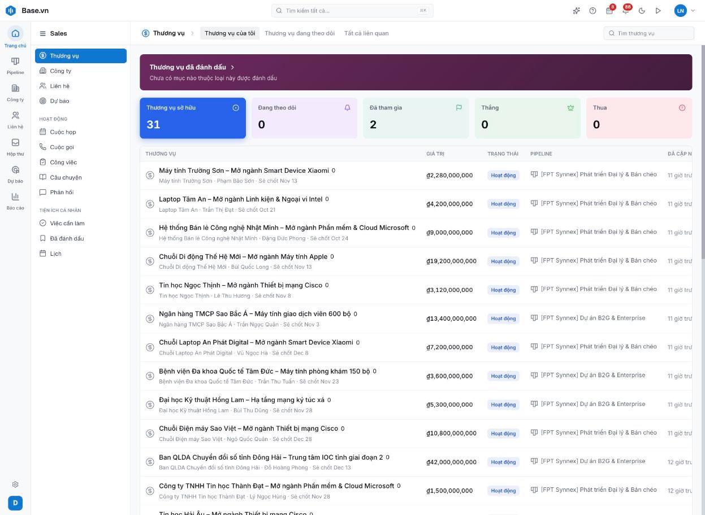{width=12.5cm}

**Bước 1 · Trang chủ Base Sales**

Long Nguyễn đang phụ trách 31 thương vụ trên 2 pipeline [FPT Synnex]: Phát triển Đại lý & Bán chéo và Dự án B2G & Enterprise.

> **Giá trị:** Mỗi Sales mở máy là thấy toàn bộ cơ hội mình phụ trách trên cả hai mảng, không phải tổng hợp từ Excel.

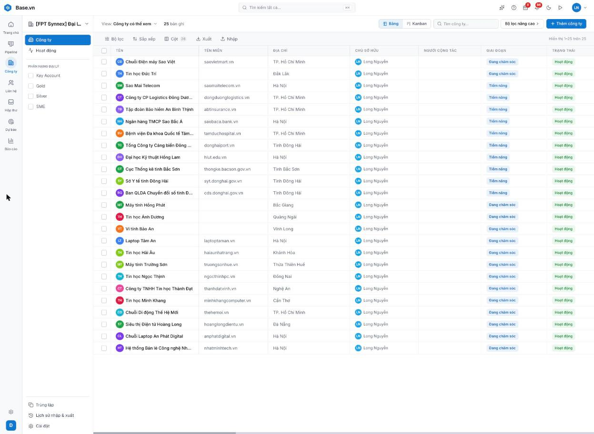{width=12.5cm}

**Bước 2 · Danh bạ Đại lý & Khách hàng**

25 bản ghi, xem dạng Bảng hoặc Kanban, cột Tên, Tên miền, Địa chỉ, Chủ sở hữu. Bộ lọc bên trái theo Phân hạng đại lý: Key Account, Gold, Silver, SME.

> **Giá trị:** Danh bạ đại lý tập trung, phân hạng rõ ràng, giúp Trưởng kênh phân bổ nguồn lực chăm sóc theo giá trị của từng account.

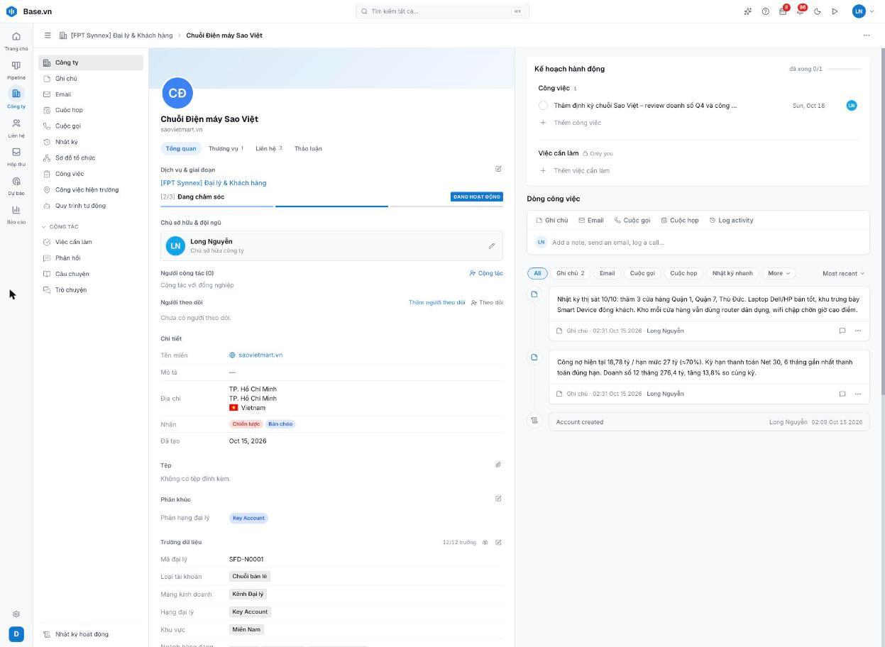{width=12.5cm}

**Bước 3 · Kế hoạch hành động của account**

Công việc đang mở: "Thẩm định kỳ chuỗi Sao Việt – review doanh số Q4 và công…", hạn Sun, Oct 18. Việc cần làm cá nhân ở ngay bên dưới.

> **Giá trị:** Mỗi account có kế hoạch chăm sóc cụ thể, có hạn, có người làm. Quản lý theo dõi được mà không cần hỏi lại Sales.

**Bước 4 · Ghi mọi loại hoạt động**

Dòng công việc nhận Ghi chú, Email, Cuộc gọi, Cuộc họp, Log activity. Menu trái của account có thêm Công việc hiện trường cho fieldwork và Quy trình tự động.

> **Giá trị:** Mọi cuộc gọi, email, buổi họp, chuyến đi thị trường đều nằm trên hồ sơ đại lý, không còn thất lạc trong điện thoại hay sổ tay cá nhân.

**Bước 5 · Nhật ký thị sát (fieldwork)**

"Nhật ký thị sát 10/10: thăm 3 cửa hàng Quận 1, Quận 7, Thủ Đức. Laptop Dell/HP bán tốt, khu trưng bày Smart Device đông khách. Kho mỗi cửa hàng vẫn dùng router dân dụng, wifi chập chờn giờ cao điểm."

> **Giá trị:** Thông tin thực địa trở thành dữ liệu: nhu cầu thiết bị mạng của Sao Việt được phát hiện ngay từ chuyến thăm cửa hàng.

**Bước 6 · Công nợ và nhãn chăm sóc**

"Công nợ hiện tại 18,78 tỷ / hạn mức 27 tỷ (≈70%). Kỳ hạn thanh toán Net 30, 6 tháng gần nhất thanh toán đúng hạn. Doanh số 12 tháng 276,4 tỷ, tăng 13,8% so cùng kỳ." Account gắn nhãn Chiến lược và Bán chéo.

> **Giá trị:** Sales nắm doanh số, công nợ, hạn mức trước khi gặp khách, tư vấn đúng mức và tránh đơn bị chặn.

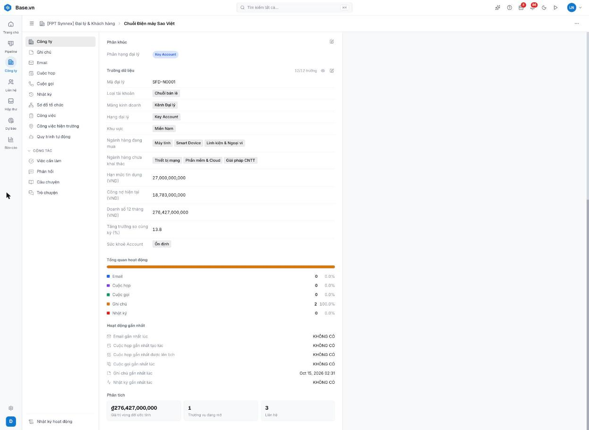{width=12.5cm}

**Bước 7 · Trường dữ liệu 12/12**

Mã đại lý SFD-N0001, Key Account, Miền Nam. Ngành hàng đang mua: Máy tính, Smart Device, Linh kiện & Ngoại vi. Chưa khai thác: Thiết bị mạng, Phần mềm & Cloud, Giải pháp CNTT. Sức khoẻ Account: Ổn định.

> **Giá trị:** Thấy rõ đại lý đã mua và chưa mua ngành hàng nào. Đây là đầu vào trực tiếp cho up-sell, cross-sell.

**Bước 8 · Tổng quan hoạt động**

Base tự đếm tương tác theo loại: 2 ghi chú, chưa có email, cuộc họp, cuộc gọi. Phân tích: giá trị vòng đời ước tính ₫276.427.000.000, 1 thương vụ đang mở, 3 liên hệ.

> **Giá trị:** Quản lý đo được mức độ chăm sóc thực tế trên từng account thay vì đánh giá cảm tính.

#### Phần 2 · Cơ hội bán chéo, báo giá và Copilot

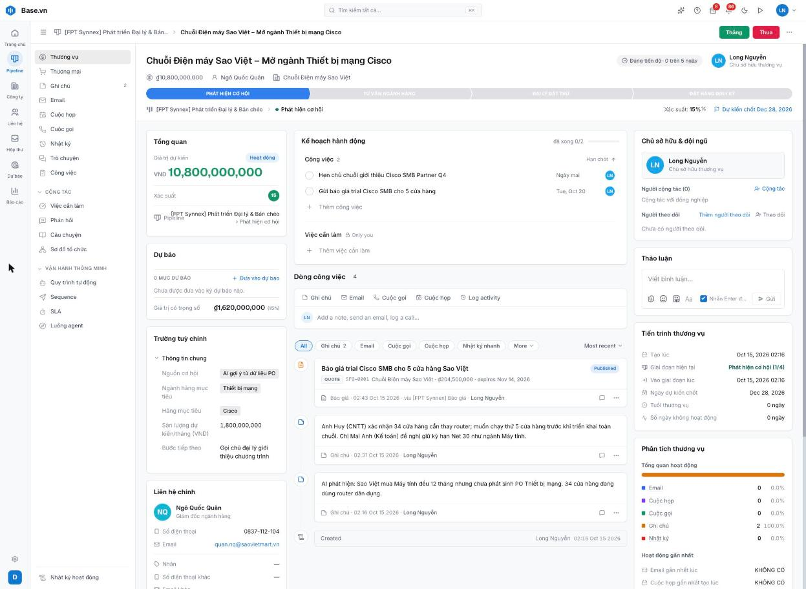{width=12.5cm}

**Bước 1 · Deal bán chéo: Mở ngành Thiết bị mạng Cisco**

₫10.800.000.000, giai đoạn Phát hiện cơ hội, xác suất 15%. Kế hoạch 2 công việc: "Hẹn chủ chuỗi giới thiệu Cisco SMB Partner Q4" (Ngày mai) và "Gửi báo giá trial Cisco SMB cho 5 cửa hàng" (Tue, Oct 20).

> **Giá trị:** Khoảng trống ngành hàng trở thành thương vụ có giá trị, giai đoạn và kế hoạch, nên tỷ lệ bán chéo đo được.

**Bước 2 · Báo giá ngay trong dòng công việc**

Báo giá SFO-0001 "Báo giá trial Cisco SMB cho 5 cửa hàng Sao Việt" ₫204.500.000, hết hạn Nov 14, 2026. Ghi chú gốc của cơ hội: "AI phát hiện: Sao Việt mua Máy tính đều 12 tháng nhưng chưa phát sinh PO Thiết bị mạng."

> **Giá trị:** Báo giá gắn liền với cơ hội và lịch sử chăm sóc, khách hỏi lại thì Sales tra một chỗ là đủ.

**Bước 3 · Vận hành thông minh**

Deal có nhóm Quy trình tự động, Sequence, SLA, Luồng agent. Trường tuỳ chỉnh ghi nguồn cơ hội "AI gợi ý từ dữ liệu PO", sản lượng 1.800.000.000/tháng.

> **Giá trị:** Quy trình tự động, SLA và nguồn cơ hội gắn sẵn trên deal, giúp đo hiệu quả của từng nguồn up-sell.

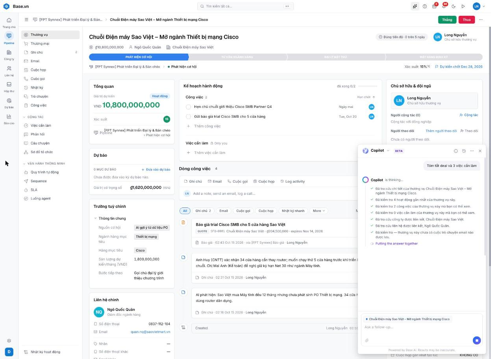{width=12.5cm}

**Bước 4 · Copilot đang tra cứu**

Câu hỏi: "Tóm tắt deal và 3 việc cần làm". Copilot lần lượt tra thương vụ, 4 hoạt động gần nhất, 2 công việc, 0 việc cần làm, công ty Chuỗi Điện máy Sao Việt, liên hệ Ngô Quốc Quân.

> **Giá trị:** Copilot tự đọc toàn bộ ngữ cảnh của deal, Sales không phải tự lục lại lịch sử.

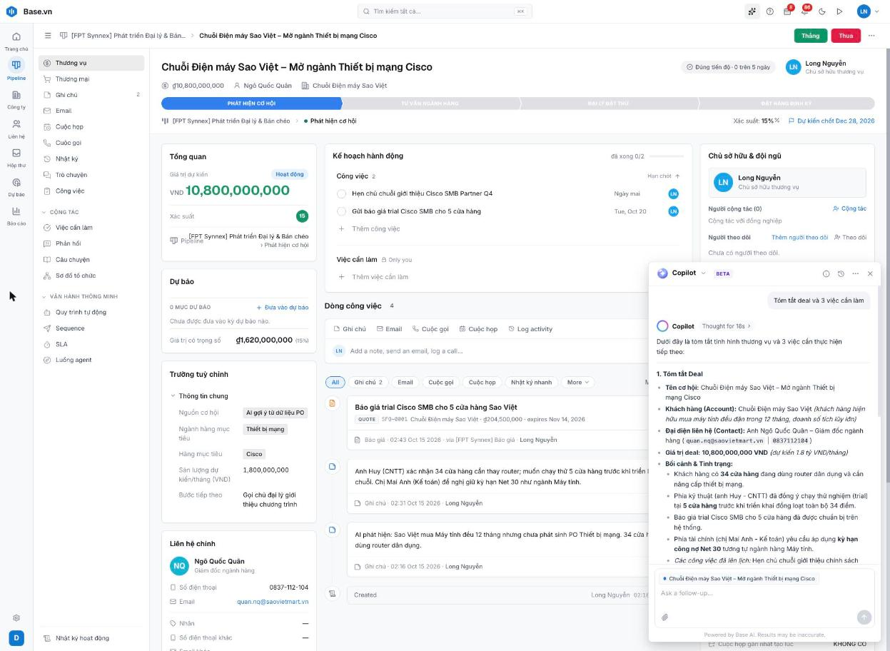{width=12.5cm}

**Bước 5 · Copilot tóm tắt deal**

Sau 18 giây: khách hàng hiện hữu mua máy tính đều 12 tháng; 34 cửa hàng dùng router dân dụng; CNTT đồng ý chạy thử 5 cửa hàng; Kế toán đề nghị kỳ hạn Net 30.

> **Giá trị:** Trong chưa đầy 20 giây, Sales hoặc người tiếp quản account nắm được toàn cảnh khách hàng.

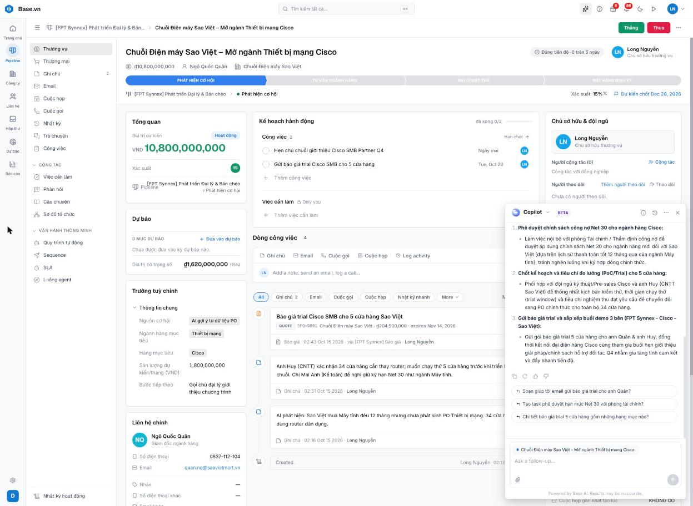{width=12.5cm}

**Bước 6 · 3 việc cần làm**

1) Phê duyệt chính sách công nợ Net 30 cho ngành hàng Cisco. 2) Chốt kế hoạch và tiêu chí PoC/Trial cho 5 cửa hàng. 3) Gửi báo giá trial và sắp xếp buổi demo 3 bên FPT Synnex – Cisco – Sao Việt. Kèm 3 câu hỏi gợi ý tiếp.

> **Giá trị:** Từ dữ liệu đến hành động: Sales biết ngay bước tiếp theo để chốt cơ hội bán chéo.

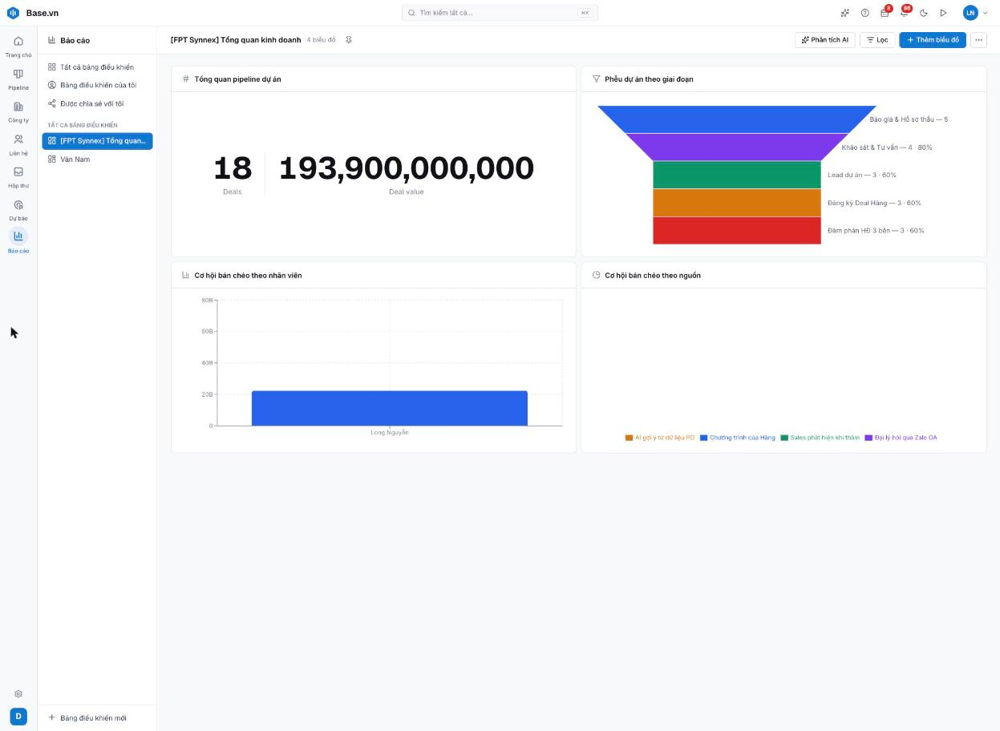{width=12.5cm}

**Bước 7 · Biểu đồ bán chéo**

Cơ hội bán chéo theo nhân viên và theo nguồn: AI gợi ý từ dữ liệu PO, Chương trình của Hãng, Sales phát hiện khi thăm, Đại lý hỏi qua Zalo OA.

> **Giá trị:** Biết cơ hội bán chéo đến từ nguồn nào và ai đang nắm, để nhân rộng nguồn hiệu quả.

### Năng lực mở rộng đã trao đổi (chưa có trong ảnh demo)

- **Gọi điện từ hệ thống:**
  - Bấm gọi ngay trên account, qua tổng đài (call center) của Synnex FPT hoặc tài khoản gọi riêng của từng Sales.
  - Cuộc gọi được ghi lại thành hoạt động.
- **Ghi âm và AI tổng kết cuộc gọi:**
  - Thiết bị ghi âm cuộc gọi kết hợp lớp AI chuyển giọng nói thành văn bản và tự tổng kết cuộc gọi.
  - Từ đó tạo việc cần làm hoặc soạn email tiếp theo.
- **Đồng bộ lịch:** kết nối lịch (calendar) cho các cuộc họp với khách.
- **Bàn giao account:** khi Sales nghỉ hoặc đổi tuyến, chỉ cần đổi người phụ trách. Toàn bộ lịch sử tương tác vẫn nằm trên account để người mới làm tiếp.

### Chỉ số đề xuất

Số hoạt động chăm sóc / account / tháng · tỷ lệ account có kế hoạch chăm sóc · số ngành hàng / account · tỷ lệ up-sell, cross-sell theo ngành hàng.

# 4. Use case 2 · Khách SME

**Bài toán.** Nhóm SME đông, doanh thu vài trăm triệu đến vài tỷ, nhưng chưa có người phụ trách riêng. Câu hỏi về chính sách, công nợ, bảo hành lặp lại hằng ngày, nhiều tin nhắn đến ngoài giờ. Hội thoại nằm trong Zalo và điện thoại cá nhân của Sales.

**Luồng giải pháp:**

1. **Kết nối kênh:**
   - Base kết nối Zalo OA, Zalo cá nhân của Sales, Facebook, WhatsApp, Live Chat trên website.
   - Zalo cá nhân được kết nối bằng thao tác quét mã và đồng bộ hai chiều: Sales nhắn trên Zalo hay trên Base đều về cùng một Hộp thư.
   - Các kênh có thể gom theo dịch vụ, ví dụ theo từng ngành hàng.
2. **AI tư vấn 24/7:** trợ lý AI trả lời bằng ngôn ngữ tự nhiên theo chính sách bán hàng. Trong lúc trò chuyện, AI tự ghi thông tin khách vào hồ sơ: tên doanh nghiệp, nhu cầu, nhóm sản phẩm.
3. **Phân về Sales:**
   - Khi khách có nhu cầu, AI chấm điểm tín hiệu mua và chuyển hội thoại hoặc Phiếu chuyển Sales cho người phụ trách.
   - Việc phân công có thể tự động theo quy tắc (ví dụ theo ngành hàng quan tâm) hoặc giao tay.
4. **Kịch bản chăm sóc tự động:** chuỗi chạm theo thời gian cho từng tệp khách. Ví dụ ngày đầu gửi email; sau 2 ngày chưa liên hệ được thì tạo việc gọi điện, nhắn tin cho Sales.
5. **Sales hỏi AI:** Copilot tóm tắt hội thoại, chỉ ra câu hỏi khách chưa được trả lời, gợi ý nội dung phản hồi.

### Kịch bản demo

#### Phần 1 · Hộp thư đa kênh, AI trả lời và tự ghi hồ sơ

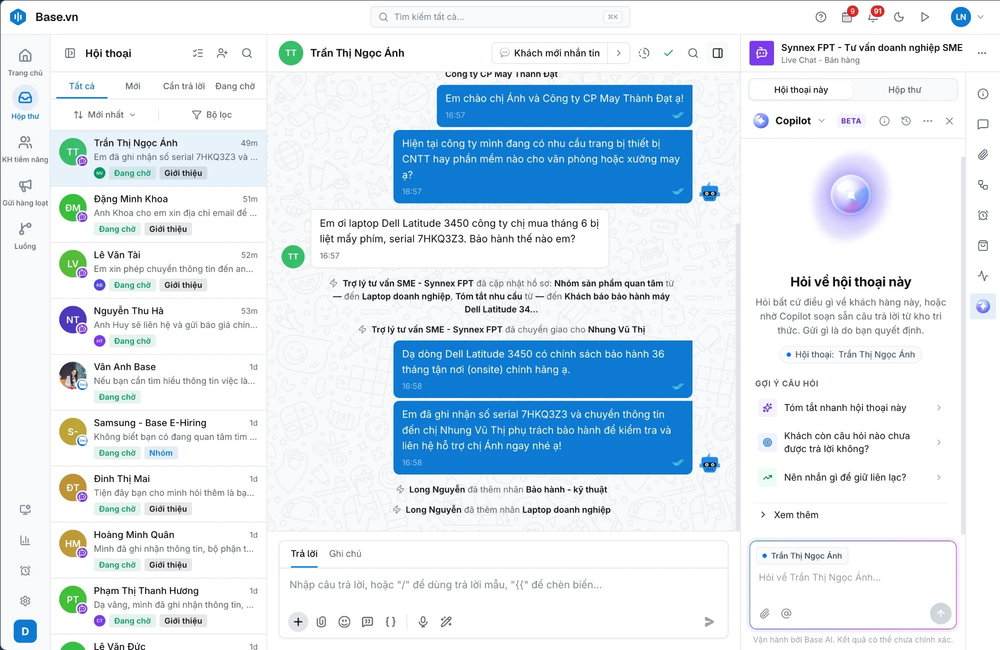{width=12.5cm}

**Bước 1 · Hộp thư hội thoại**

Mọi hội thoại của khách về một hộp thư, lọc theo Tất cả / Mới / Cần trả lời / Đang chờ. Mỗi hội thoại hiện tin nhắn cuối, thời gian, trạng thái Đang chờ và nhãn như Giới thiệu, Nhóm.

> **Giá trị:** Mọi hội thoại với đại lý và khách về một hộp thư; quản lý thấy được ai đang chờ trả lời.

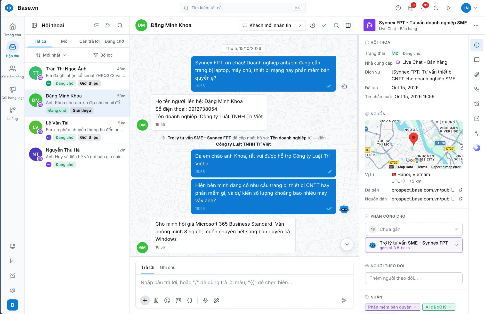{width=12.5cm}

**Bước 2 · AI chào và hỏi nhu cầu**

Trợ lý mở lời: "Synnex FPT xin chào! Doanh nghiệp anh/chị đang cần trang bị laptop, máy chủ, thiết bị mạng hay phần mềm bản quyền ạ?" Khách để lại họ tên Đặng Minh Khoa, số điện thoại 0912738054, doanh nghiệp Công ty Luật TNHH Trí Việt.

> **Giá trị:** AI tiếp khách ngay lập tức, kể cả ngoài giờ, và lấy thông tin liên hệ ngay từ đầu.

**Bước 3 · AI tự ghi nhận thông tin vào hồ sơ**

"Trợ lý tư vấn SME - Synnex FPT đã cập nhật hồ sơ: Tên doanh nghiệp từ — đến Công ty Luật TNHH Trí Việt", rồi chào anh Khoa và hỏi tiếp nhu cầu thiết bị, phần mềm và số lượng máy.

> **Giá trị:** Thông tin khách tự thành dữ liệu CRM, Sales không phải nhập lại.

**Bước 4 · Khách hỏi bằng ngôn ngữ tự nhiên**

"Cho mình hỏi giá Microsoft 365 Business Standard. Văn phòng mình 8 người, muốn chuyển hết sang bản quyền cả Windows".

> **Giá trị:** Khách hỏi tự nhiên như nói chuyện với người, không cần menu hay biểu mẫu.

**Bước 5 · Thông tin hội thoại và nguồn**

Trạng thái Mở · Đang chờ; nhà cung cấp Live Chat - Bán hàng; dịch vụ [Synnex FPT] Tư vấn thiết bị CNTT cho doanh nghiệp SME; tạo ngày Oct 15, 2026. Nguồn: vị trí Hanoi, Vietnam, khách đến từ trang prospect.base.com.vn.

> **Giá trị:** Biết khách đến từ kênh, trang và dịch vụ nào để đánh giá hiệu quả từng kênh.

**Bước 6 · AI đang xử lý, chưa cần gán Sales**

Phân công cho: chưa gán người; Trợ lý tư vấn SME - Synnex FPT (gemini-3.8-flash) đang trả lời. Nhãn hội thoại: Phần mềm bản quyền, AI đã xử lý.

> **Giá trị:** Câu hỏi phổ biến được AI xử lý trọn vẹn, Sales chỉ tham gia khi thật sự cần.

{width=12.5cm}

**Bước 7 · Kịch bản AI kết hợp Sales**

Khách báo laptop Dell Latitude 3450 mua tháng 6 bị liệt mấy phím, serial 7HKQ3Z3. Trợ lý cập nhật Nhóm sản phẩm quan tâm → Laptop doanh nghiệp, Tóm tắt nhu cầu → Khách báo bảo hành máy Dell Latitude 34…, rồi chuyển giao cho Nhung Vũ Thị.

> **Giá trị:** AI và Sales phối hợp trong cùng một hội thoại: AI thu thập, Sales tiếp nhận khi khách có nhu cầu.

**Bước 8 · Trả lời và chuyển người phụ trách**

"Dạ dòng Dell Latitude 3450 có chính sách bảo hành 36 tháng tận nơi (onsite) chính hãng ạ." Trợ lý ghi nhận serial và chuyển chị Nhung Vũ Thị phụ trách bảo hành. Long Nguyễn thêm nhãn Bảo hành - kỹ thuật và Laptop doanh nghiệp.

> **Giá trị:** Khách được trả lời ngay và chuyển đúng người phụ trách, không phải kể lại từ đầu.

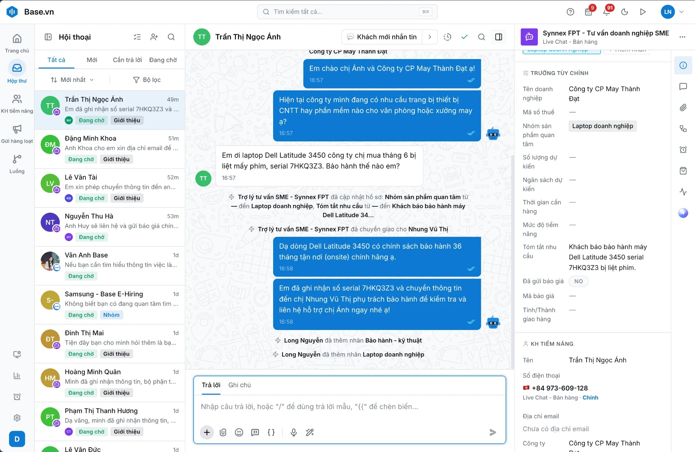{width=12.5cm}

**Bước 9 · Dữ liệu AI ghi vào hệ thống**

Trường tuỳ chỉnh do trợ lý điền: Tên doanh nghiệp Công ty CP May Thành Đạt · Nhóm sản phẩm quan tâm Laptop doanh nghiệp · Tóm tắt nhu cầu "Khách báo bảo hành máy Dell Latitude 3450 serial 7HKQ3Z3 bị liệt phím" · Đã gửi báo giá NO. Các trường chờ bổ sung: Mã số thuế, Số lượng, Ngân sách, Thời gian cần hàng, Mức độ tiềm năng, Mã báo giá, Tỉnh/Thành giao hàng.

> **Giá trị:** Dữ liệu khách hàng được làm giàu sau mỗi hội thoại, phục vụ phân loại và chăm sóc tiếp.

**Bước 10 · Hồ sơ khách hàng tiềm năng**

KH tiềm năng Trần Thị Ngọc Ánh, số điện thoại +84 973-609-128 (Live Chat - Bán hàng · Chính), chưa có địa chỉ email, công ty Công ty CP May Thành Đạt.

> **Giá trị:** Hồ sơ khách tiềm năng tạo tự động từ hội thoại, lead không thất thoát.

{width=12.5cm}

**Bước 11 · Sales hỏi đáp AI về hội thoại**

Copilot "Hỏi về hội thoại này": hỏi bất cứ điều gì về khách, hoặc nhờ Copilot soạn sẵn câu trả lời từ kho tri thức; gửi gì là do Sales quyết định. Gợi ý: Tóm tắt nhanh hội thoại này · Khách còn câu hỏi nào chưa được trả lời không? · Nên nhắn gì để giữ liên lạc?

> **Giá trị:** Sales hỏi AI để nắm nhanh hội thoại và soạn phản hồi; quyết định gửi vẫn thuộc về Sales.

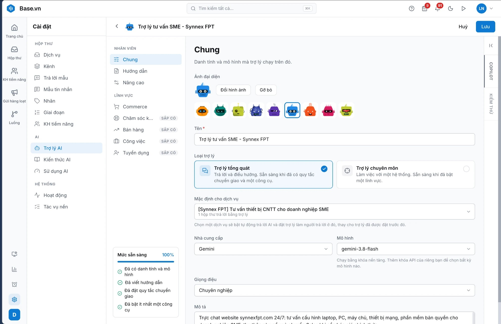{width=12.5cm}

**Bước 12 · Cấu hình Trợ lý tư vấn SME**

Trợ lý tổng quát: trả lời và điều hướng, sẵn sàng khi đã có quy tắc chuyển giao và một công cụ. Mặc định cho dịch vụ [Synnex FPT] Tư vấn thiết bị CNTT cho doanh nghiệp SME (1 hộp thư trả lời bằng trợ lý). Nhà cung cấp Gemini, mô hình gemini-3.8-flash.

> **Giá trị:** Trợ lý cấu hình theo từng dịch vụ và hộp thư, triển khai nhanh cho nhiều kênh.

**Bước 13 · Mức sẵn sàng 100%**

Thiết lập Chung, Hướng dẫn, Nâng cao; lĩnh vực Commerce, các lĩnh vực Chăm sóc khách hàng, Bán hàng, Công việc, Tuyển dụng ghi Sắp có. Checklist: đã có danh tính và mô hình, đã viết hướng dẫn, đã đặt quy tắc chuyển giao, đã bật ít nhất một công cụ.

> **Giá trị:** Checklist sẵn sàng giúp triển khai có kiểm soát trước khi AI tiếp khách thật.

#### Phần 2 · Trợ lý chăm sóc đại lý SME trả lời chính sách và chuyển Sales

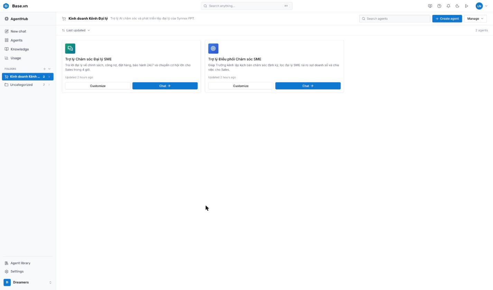{width=12.5cm}

**Bước 1 · Folder Kinh doanh Kênh Đại lý**

2 trợ lý trên AgentHub: Trợ lý Chăm sóc Đại lý SME (trả lời đại lý 24/7, chuyển cơ hội lớn cho Sales trong 4 giờ) và Trợ lý Điều phối Chăm sóc SME (cho Trưởng kênh).

> **Giá trị:** Đại lý SME chưa có người phụ trách vẫn được chăm sóc 24/7, giảm workload cho đội Sales.

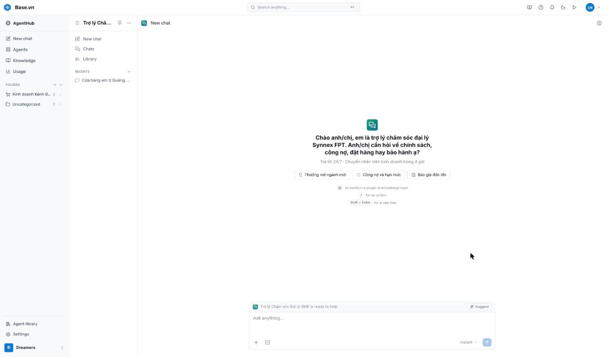{width=12.5cm}

**Bước 2 · Màn hình chào**

"Chào anh/chị, em là trợ lý chăm sóc đại lý Synnex FPT. Anh/chị cần hỏi về chính sách, công nợ, đặt hàng hay bảo hành ạ?" · Trả lời 24/7 · Chuyển nhân viên kinh doanh trong 4 giờ.

> **Giá trị:** Đại lý có một điểm hỏi duy nhất cho chính sách, công nợ, đặt hàng và bảo hành.

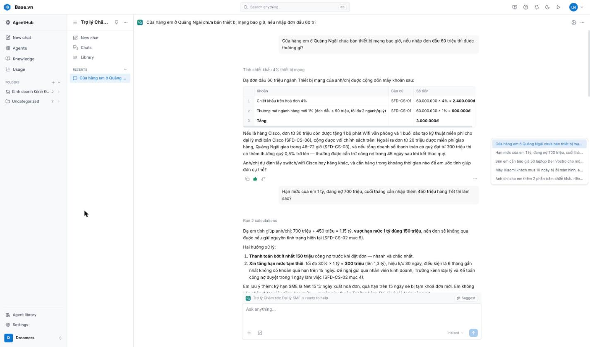{width=12.5cm}

**Bước 3 · Câu 1 · Thưởng mở ngành mới**

Đơn đầu 60 triệu Thiết bị mạng: chiết khấu 4% = 2.400.000đ + thưởng mở ngành 1% = 600.000đ, tổng 3.000.000đ, căn cứ SFD-CS-01.

> **Giá trị:** Câu trả lời có tính toán cụ thể và trích số chính sách, đại lý tin tưởng, Sales không phải trả lời lặp lại.

**Bước 4 · Cộng dồn chương trình Hãng**

Hàng Cisco từ 30 triệu được tặng 1 bộ phát Wifi văn phòng và 1 buổi đào tạo (SFD-CS-06); từ 20 triệu miễn phí giao, Quảng Ngãi 48–72 giờ (SFD-CS-03). Trợ lý hỏi lại hãng và thời điểm nhập.

> **Giá trị:** AI chủ động cộng dồn ưu đãi của Hãng, tăng khả năng chốt đơn mở ngành mới.

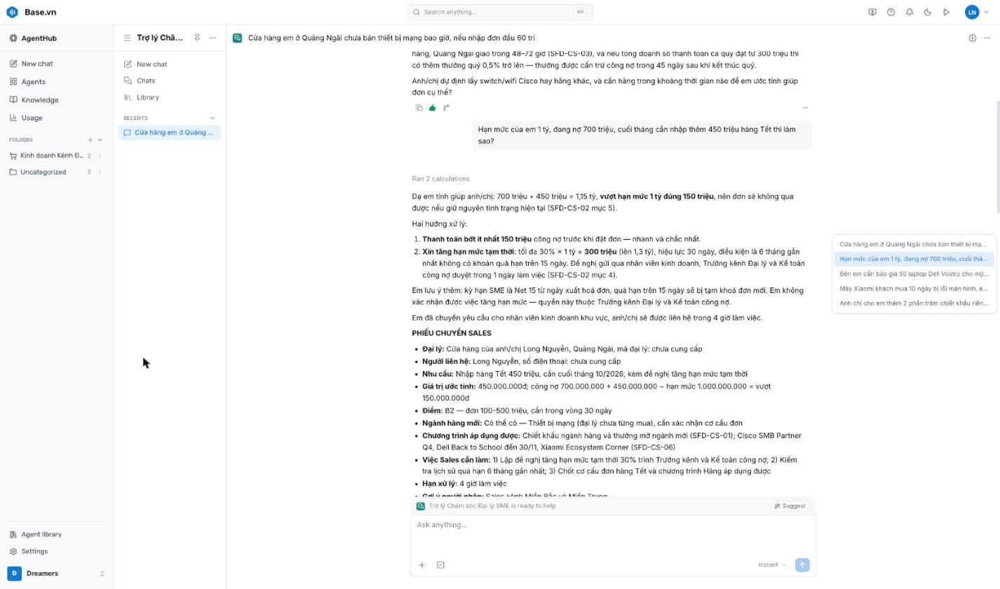{width=12.5cm}

**Bước 5 · Câu 2 · Hạn mức và công nợ**

Trợ lý chạy 2 phép tính: 700 triệu + 450 triệu = 1,15 tỷ, vượt hạn mức 1 tỷ đúng 150 triệu (SFD-CS-02). Hai hướng: thanh toán bớt 150 triệu, hoặc xin tăng hạn mức tạm thời tối đa 30% = 300 triệu.

> **Giá trị:** Đại lý biết ngay tình trạng hạn mức và cách xử lý, tránh đặt hàng rồi bị chặn.

**Bước 6 · Phiếu chuyển Sales B2**

Trợ lý không tự duyệt hạn mức, lập PHIẾU CHUYỂN SALES: nhu cầu nhập hàng Tết 450 triệu, điểm B2 (đơn 100–500 triệu, cần trong 30 ngày), hạn xử lý 4 giờ làm việc.

> **Giá trị:** AI không vượt quyền: việc cần duyệt được chuyển cho Sales kèm đủ thông tin và hạn xử lý.

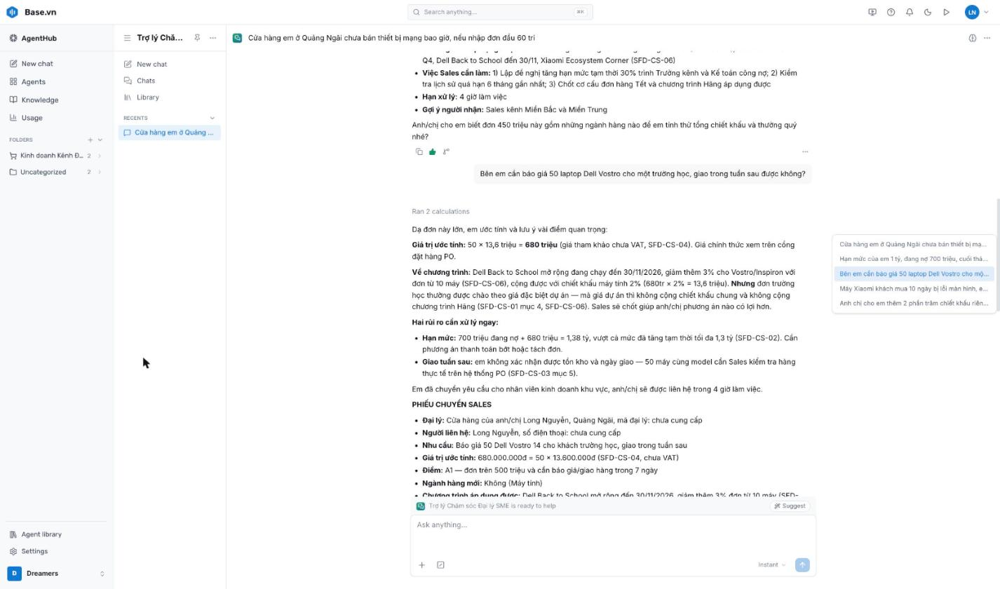{width=12.5cm}

**Bước 7 · Câu 3 · Báo giá 50 Dell Vostro**

50 × 13,6 triệu = 680 triệu (SFD-CS-04). Dell Back to School giảm thêm 3% đến 30/11. Cảnh báo 2 rủi ro: 700 triệu nợ + 680 triệu = 1,38 tỷ vượt cả mức tạm thời 1,3 tỷ; chưa xác nhận được tồn kho và ngày giao.

> **Giá trị:** Báo giá tức thì kèm cảnh báo rủi ro, đơn lớn không bị bỏ sót.

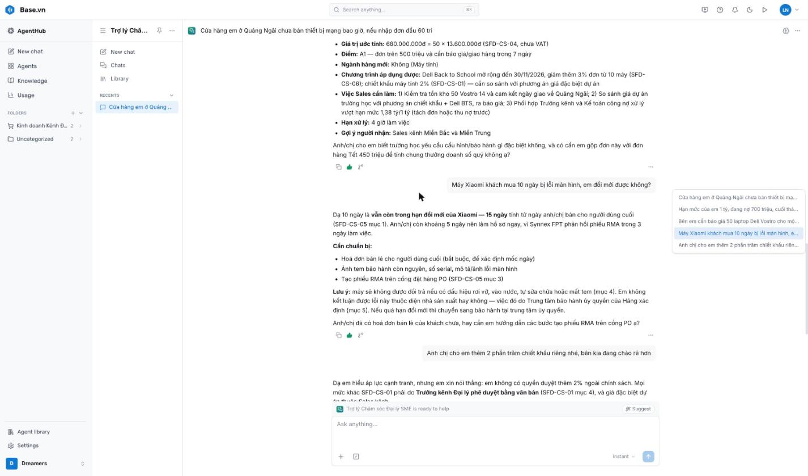{width=12.5cm}

**Bước 8 · Phiếu chuyển Sales A1**

Điểm A1: đơn trên 500 triệu và cần báo giá/giao hàng trong 7 ngày. Việc Sales cần làm: kiểm tra tồn kho 50 Vostro 14, so sánh giá dự án trường học, phối hợp xử lý vượt hạn mức. Hạn 4 giờ làm việc.

> **Giá trị:** Cơ hội lớn đến tay Sales trong 4 giờ, có điểm ưu tiên rõ ràng.

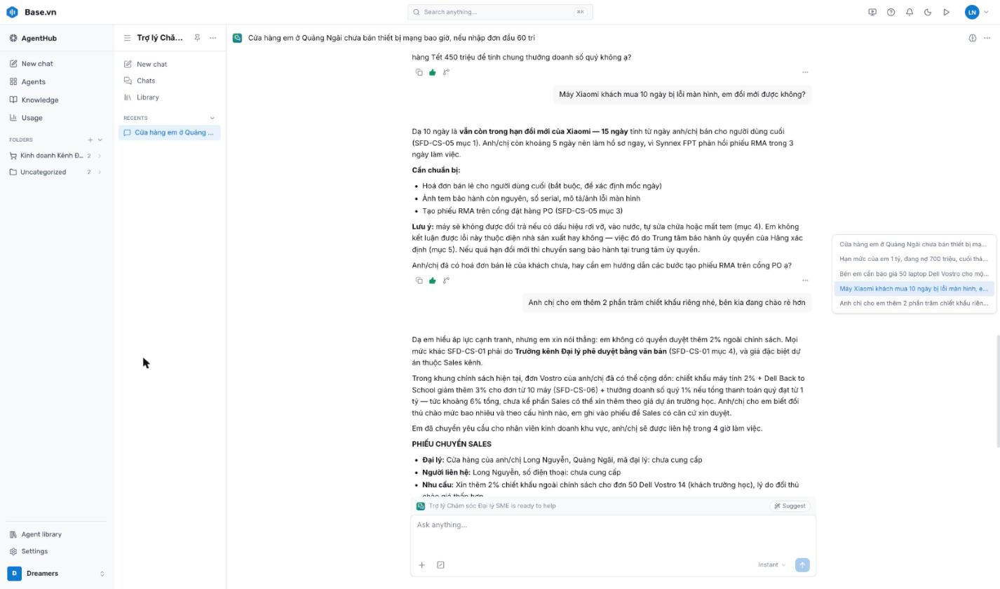{width=12.5cm}

**Bước 9 · Câu 4 · Bảo hành Xiaomi**

10 ngày vẫn trong hạn đổi mới 15 ngày của Xiaomi (SFD-CS-05). Hướng dẫn chuẩn bị hoá đơn bán lẻ, ảnh tem, serial và tạo phiếu RMA. Trợ lý không tự kết luận lỗi.

> **Giá trị:** Hỗ trợ sau bán đúng chính sách Hãng, giảm tải cho bộ phận bảo hành.

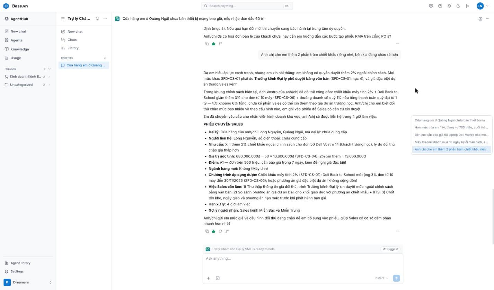{width=12.5cm}

**Bước 10 · Câu 5 · Xin thêm 2% chiết khấu**

Trợ lý từ chối lịch sự: mức ngoài SFD-CS-01 phải do Trưởng kênh Đại lý duyệt bằng văn bản. Gợi ý mức cộng dồn khoảng 6% trong chính sách và lập phiếu chuyển Sales A1 kèm đề nghị giá đặc biệt.

> **Giá trị:** Giữ biên lợi nhuận: AI bám khung chiết khấu và chuyển đề nghị ngoại lệ cho người có thẩm quyền.

#### Phần 3 · Kịch bản chăm sóc 30 ngày cho Trưởng kênh

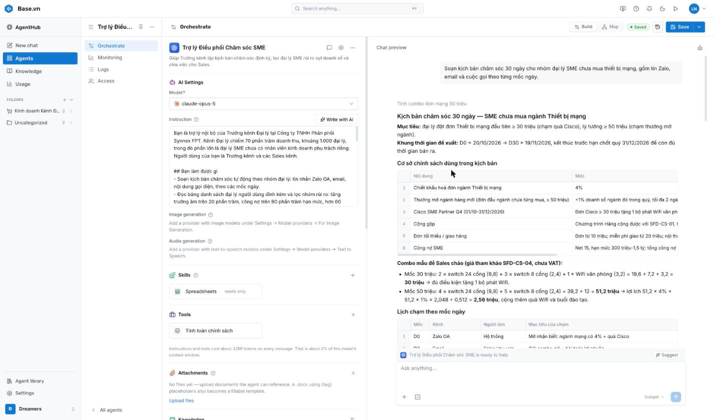{width=12.5cm}

**Bước 1 · Trợ lý Điều phối Chăm sóc SME**

Trưởng kênh yêu cầu: "Soạn kịch bản chăm sóc 30 ngày cho nhóm đại lý SME chưa mua thiết bị mạng". Trợ lý nêu mục tiêu, khung D0 = 20/10 → D30 = 19/11/2026, cơ sở chính sách và 2 combo 30 triệu / 51,2 triệu.

> **Giá trị:** Trưởng kênh có ngay kịch bản chăm sóc nhóm SME bám sát chính sách, chỉ cần duyệt và triển khai.

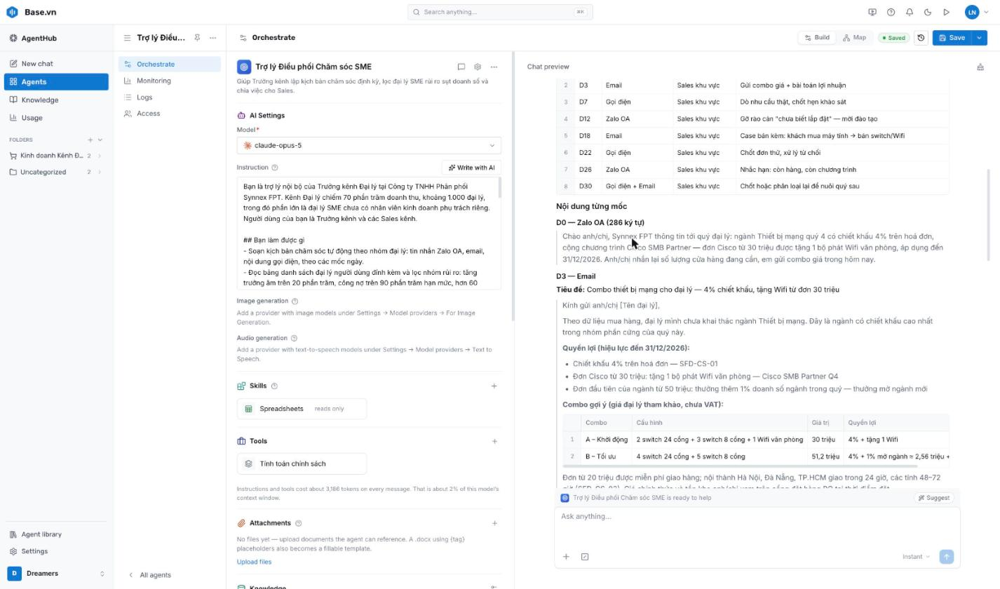{width=12.5cm}

**Bước 2 · Lịch chạm 8 mốc**

D0 Zalo OA · D3 Email · D7 Gọi điện · D12 Zalo OA · D18 Email · D22 Gọi điện · D26 Zalo OA · D30 Gọi điện + Email, mỗi mốc có người làm và mục tiêu. Bên dưới là nội dung tin D0 (286 ký tự).

> **Giá trị:** Chăm sóc SME thành lịch chạm đều đặn trên nhiều kênh, không phụ thuộc trí nhớ của từng người.

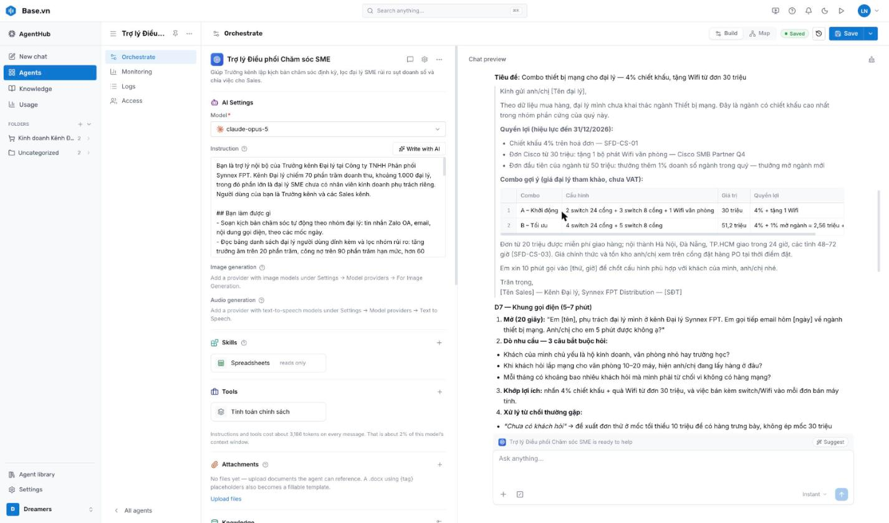{width=12.5cm}

**Bước 3 · Email D3 và khung gọi D7**

Email combo thiết bị mạng: 4% chiết khấu, tặng Wifi từ đơn 30 triệu, bảng combo A/B. Khung gọi D7 5–7 phút với 3 câu hỏi dò nhu cầu bắt buộc và cách xử lý từ chối.

> **Giá trị:** Nội dung soạn sẵn đúng chính sách, Sales chỉ cần gửi và gọi theo khung.

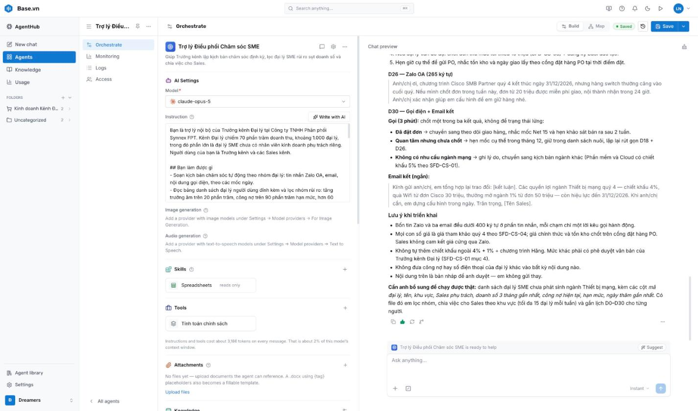{width=12.5cm}

**Bước 4 · Chốt D26, D30 và lưu ý triển khai**

D26 Zalo nhắc hạn (265 ký tự); D30 gọi chốt một trong ba kết quả. Lưu ý: tin dưới 400 ký tự, không tự thêm chiết khấu, nội dung là bản nháp để Trưởng kênh duyệt.

> **Giá trị:** Mọi nội dung là bản nháp chờ duyệt, Synnex FPT giữ quyền kiểm soát thông điệp.

### Năng lực mở rộng đã trao đổi (chưa có trong ảnh demo)

- **Màn hình kết nối kênh:** Zalo OA, Zalo cá nhân (quét mã, đồng bộ hai chiều), Facebook, WhatsApp.
- **Kho lead tập trung:** khách từ quảng cáo, website, tin nhắn đổ về một nơi, kèm nguồn, ngày tạo, nhu cầu quan tâm. Lead được chấm điểm và tự giao cho nhóm Sales theo quy tắc.
- **Automation theo tệp khách:** mỗi nguồn (Facebook, sự kiện, hội thảo, Zalo) có kịch bản chăm sóc riêng. Data chưa được khai thác được đánh giá lại theo chu kỳ.
- **Báo cáo hội thoại:** thời gian phản hồi, hội thoại theo kênh, theo Sales.

### Chỉ số đề xuất

Thời gian phản hồi đầu tiên · tỷ lệ câu hỏi AI xử lý trọn vẹn · số cơ hội chuyển Sales và tỷ lệ chuyển thành đơn · tỷ lệ hội thoại có người phụ trách.

# 5. Use case 3 · Khách B2G

**Bài toán.** Gói thầu kéo dài nhiều tháng, nhiều bên tham gia (chủ đầu tư, Hãng, SI), hợp đồng 3 bên. Khó biết deal đang nghẽn ở đâu, ai đang làm gì, báo giá đã qua bao nhiêu phiên bản và đã được duyệt chưa.

**Luồng giải pháp:**

1. **Pipeline B2G 5 giai đoạn:** Lead dự án → Khảo sát & Tư vấn → Đăng ký Deal Hãng → Báo giá & Hồ sơ thầu → Đàm phán HĐ 3 bên. Mỗi giai đoạn có SLA, nên gói thầu trễ hoặc treo được cảnh báo là điểm nóng.
2. **Hồ sơ gói thầu:** trường dữ liệu đặc thù gồm Hãng chính, SI, nguồn vốn, tình trạng bảo vệ dự án, giá đặc biệt và bước tiếp theo.
3. **Bán hàng theo team dự án:**
   - Người phụ trách, lãnh đạo tham vấn và thành viên hỗ trợ (tài liệu, lịch hẹn) cùng làm việc trên deal.
   - Phân quyền chi tiết, ví dụ có người xem được thông tin khách nhưng không xem được số điện thoại hay giá.
4. **Báo giá:** báo giá tạo trên Base, lưu các phiên bản và luồng phê duyệt ngay trên gói thầu. Ký hợp đồng và PO vẫn xử lý trên hệ thống hiện có.
5. **AI:** phân tích lịch sử chăm sóc và giá trị gói thầu, đánh giá có nên tham gia và cần làm gì tiếp theo. AI cũng đọc dashboard để chỉ ra rủi ro.

### Kịch bản demo

#### Phần 1 · Pipeline và hồ sơ gói thầu

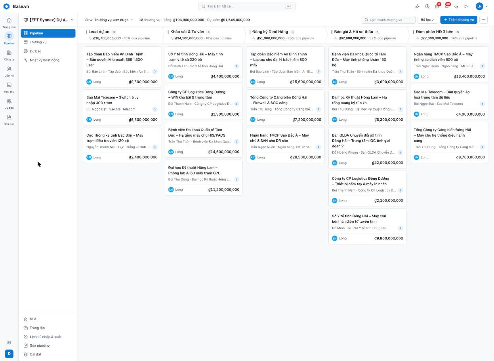{width=12.5cm}

**Bước 1 · Pipeline Dự án B2G & Enterprise**

18 thương vụ · Tổng ₫193.900.000.000 · Dự kiến ₫91.545.000.000 (giá trị nhân xác suất từng giai đoạn).

> **Giá trị:** Ban lãnh đạo thấy ngay quy mô pipeline dự án và doanh thu dự kiến theo xác suất, phục vụ dự báo.

**Bước 2 · 5 giai đoạn bán hàng B2G**

Lead dự án 3 deal · Khảo sát & Tư vấn 4 · Đăng ký Deal Hãng 3 · Báo giá & Hồ sơ thầu 5 · Đàm phán HĐ 3 bên 3. Mỗi cột hiện tổng giá trị và % của pipeline.

> **Giá trị:** Quy trình B2G chuẩn hoá thành 5 giai đoạn từ lead đến đàm phán HĐ 3 bên, biết ngay deal đang nghẽn ở đâu.

**Bước 3 · SLA và kiểm soát dữ liệu**

Ngay trên pipeline: SLA theo giai đoạn, Trùng lặp, Lịch sử nhập & xuất, Sửa pipeline, Cài đặt.

> **Giá trị:** SLA theo giai đoạn cảnh báo deal nằm quá lâu một chỗ; kiểm soát trùng lặp giữ dữ liệu sạch.

**Bước 4 · Deal chủ lực ở cột Báo giá & Hồ sơ thầu**

Ban QLDA Chuyển đổi số tỉnh Đông Hải – Trung tâm IOC tỉnh giai đoạn 2, ₫42.000.000.000.

> **Giá trị:** Deal chủ lực được nhận diện ngay trên kanban để tập trung nguồn lực.

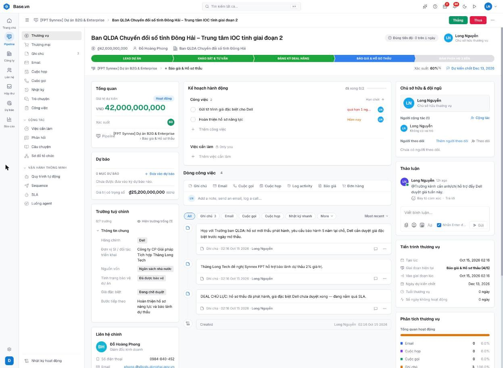{width=12.5cm}

**Bước 5 · Bán hàng theo giai đoạn**

Deal đã qua Lead dự án, Khảo sát & Tư vấn, Đăng ký Deal Hãng và đang ở Báo giá & Hồ sơ thầu (4/5), xác suất 60%. SLA giai đoạn: Đúng tiến độ · 0 trên 1 ngày.

> **Giá trị:** Cả team biết chính xác deal đang ở bước nào và còn trong SLA hay không.

**Bước 6 · Kế hoạch làm việc của deal**

"Gửi tờ trình giá đặc biệt cho Dell" đang quá hạn 1 ngày. "Hoàn thiện hồ sơ năng lực" hạn hôm nay. Đã xong 0/2.

> **Giá trị:** Việc nào chậm hiện cảnh báo quá hạn, được xử lý trước khi ảnh hưởng tiến độ thầu.

**Bước 7 · Trường tuỳ chỉnh của deal B2G**

Hãng chính Dell · SI: Công ty CP Giải pháp Tích hợp Thăng Long Tech · Nguồn vốn Ngân sách nhà nước · Tình trạng bảo vệ dự án: Đã được bảo vệ · Giá đặc biệt: Đang chờ duyệt · Bước tiếp theo: Hoàn thiện hồ sơ năng lực và bảo lãnh dự thầu.

> **Giá trị:** Thông tin đặc thù B2G (Hãng, SI, nguồn vốn, bảo vệ dự án, giá đặc biệt) thành trường dữ liệu để lọc và báo cáo.

**Bước 8 · Team dự án trên deal**

Chủ sở hữu và đội ngũ: chủ sở hữu, người cộng tác, người theo dõi. Thảo luận: "@Trưởng kênh cần anh/chị hỗ trợ đẩy Dell duyệt giá tuần này."

> **Giá trị:** Team dự án nhiều bên phối hợp ngay trên deal, tag đúng người cần hỗ trợ thay vì email rời rạc.

**Bước 9 · Dòng công việc của deal**

Họp với Trưởng ban QLDA về hồ sơ mời thầu và yêu cầu bảo hành 5 năm; Thăng Long Tech đề nghị hỗ trợ bảo lãnh dự thầu 2%; ghi chú deal chủ lực chờ Dell duyệt giá.

> **Giá trị:** Toàn bộ quá trình chăm sóc và chốt deal được lưu vết, phục vụ review và bàn giao.

#### Phần 2 · Báo cáo và AI phân tích

{width=12.5cm}

**Bước 1 · Dashboard Tổng quan kinh doanh**

18 Deals · 193,900,000,000 Deal value. Phễu dự án theo giai đoạn: Báo giá & Hồ sơ thầu 5, Khảo sát & Tư vấn 4, Lead dự án 3, Đăng ký Deal Hãng 3, Đàm phán HĐ 3 bên 3.

> **Giá trị:** Dashboard chạy trên dữ liệu thật, không cần tổng hợp báo cáo thủ công cuối tuần.

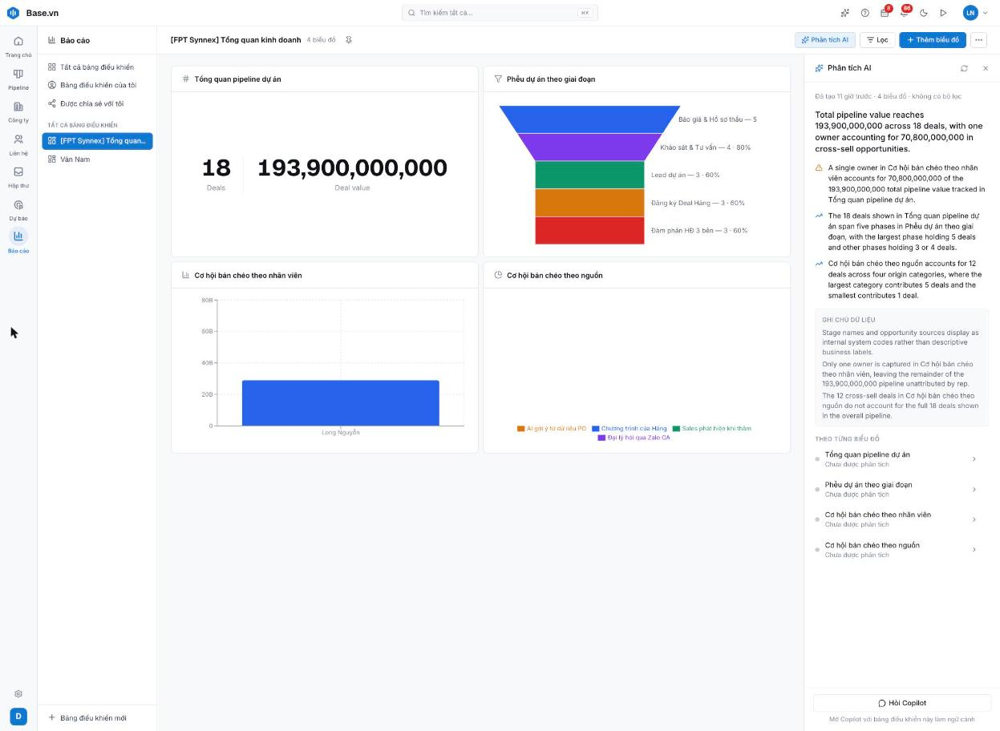{width=12.5cm}

**Bước 2 · Phân tích AI đọc dashboard**

Bản dịch: "Tổng giá trị pipeline đạt 193,9 tỷ trên 18 deal, một chủ sở hữu nắm 70,8 tỷ cơ hội bán chéo." · Một Sales duy nhất nắm 70,8 tỷ bán chéo · 18 deal trải 5 giai đoạn, giai đoạn lớn nhất 5 deal · 12 deal bán chéo thuộc 4 nguồn, lớn nhất 5, nhỏ nhất 1.

> **Giá trị:** AI đọc số và chỉ ra điểm cần chú ý, ví dụ rủi ro cơ hội dồn vào một Sales.

### Năng lực mở rộng đã trao đổi (chưa có trong ảnh demo)

- **Phân quyền theo trường dữ liệu** trên từng gói thầu, ví dụ ẩn số điện thoại hoặc giá với một số thành viên.
- **Phiên bản báo giá và luồng phê duyệt** trên deal.
- **AI đánh giá gói thầu:** hỏi đáp ngay trên deal, AI đánh giá nên tham gia hay không và đề xuất kế hoạch hành động.
- **Báo cáo theo cấp quản lý:** doanh thu tháng, tỷ lệ chuyển đổi, cơ hội theo nguồn. AI hỗ trợ dựng báo cáo và tìm điểm nóng.

### Chỉ số đề xuất

Số gói thầu quá SLA theo giai đoạn · tỷ lệ chuyển giai đoạn · số việc quá hạn trên deal · doanh thu dự kiến theo xác suất.

# 6. Quản trị AI (dùng chung cho 3 use case)

AI làm theo cấu hình của Synnex FPT:

- **Mô hình:** chọn model AI.
- **Hướng dẫn:** vai trò, việc được làm, giới hạn, giọng điệu, định dạng câu trả lời.
- **Kỹ năng và công cụ:** những gì AI được dùng để tra cứu và thao tác.
- **Đo lường:** chất lượng, độ trễ, lỗi và log từng câu hỏi để kiểm tra.

Mỗi nhân viên có thể dựng trợ lý của riêng mình trong phạm vi được phân quyền. Agent còn có thể đóng vai một bước trong quy trình tự động.

#### Kịch bản demo

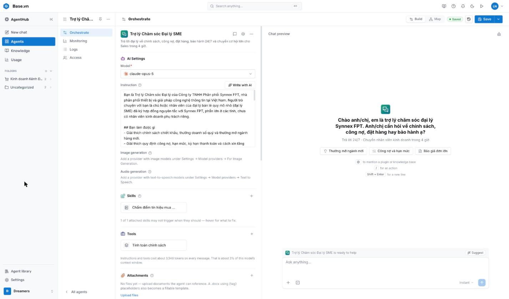{width=12.5cm}

**Bước 1 · Cấu hình Trợ lý Chăm sóc Đại lý SME**

Model AI đã chọn · Instruction mô tả vai trò, việc được làm, giới hạn · Skill "Chấm điểm tín hiệu mua" · Tool group "Tính toán chính sách".

> **Giá trị:** Synnex FPT tự định nghĩa vai trò, giới hạn và công cụ của AI.

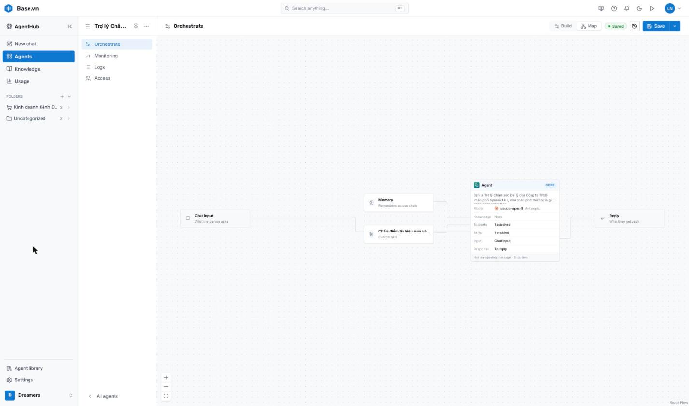{width=12.5cm}

**Bước 2 · Sơ đồ luồng của agent**

Chat input → Memory và skill Chấm điểm tín hiệu mua → Agent (Toolsets 1 attached, Skills 1 enabled, 3 starters) → Reply.

> **Giá trị:** Luồng xử lý minh bạch, kiểm tra được AI dùng dữ liệu và kỹ năng nào.

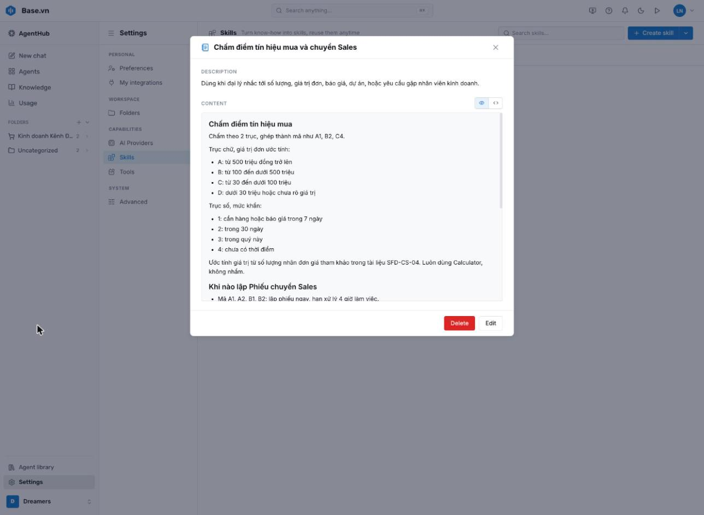{width=12.5cm}

**Bước 3 · Skill Chấm điểm tín hiệu mua và chuyển Sales**

Trục chữ theo giá trị đơn: A từ 500 triệu, B 100–500, C 30–100, D dưới 30. Trục số theo mức khẩn: 1 trong 7 ngày, 2 trong 30 ngày, 3 trong quý, 4 chưa có thời điểm. A1, A2, B1, B2: lập phiếu ngay, hạn 4 giờ.

> **Giá trị:** Quy tắc ưu tiên cơ hội do Synnex FPT đặt ra được AI áp dụng nhất quán cho mọi đại lý.

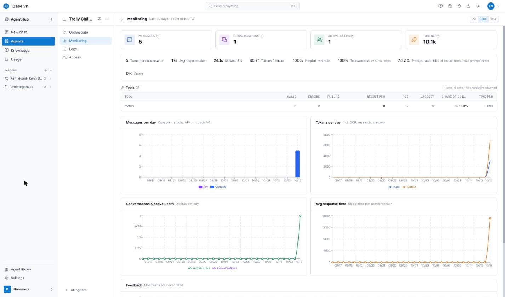{width=12.5cm}

**Bước 4 · Monitoring 30 ngày**

5 tin nhắn · 1 cuộc trò chuyện · 10,1k token · 17s phản hồi trung bình · 100% Helpful (5/5) · 100% Tool success (6 bước) · 76,2% prompt cache · 0% lỗi.

> **Giá trị:** Chất lượng AI đo bằng số liệu: tỷ lệ hữu ích, độ trễ, lỗi, chi phí token.

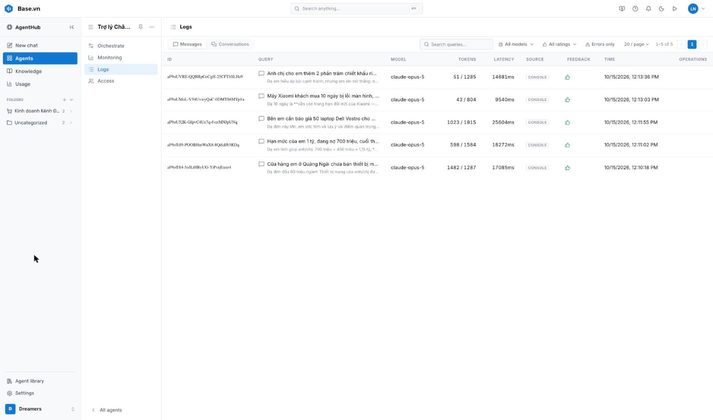{width=12.5cm}

**Bước 5 · Logs từng câu hỏi**

5 câu hỏi của đại lý, model AI đã chọn, nguồn CONSOLE, cả 5 đều được đánh giá tốt, có token và độ trễ từng lượt.

> **Giá trị:** Mọi câu trả lời được lưu lại để kiểm tra, đánh giá và cải tiến.

# 7. Điểm cần làm rõ sau buổi làm việc

| # | Nội dung | Phụ trách |
|---|---|---|
| 1 | Cơ chế dùng nhãn phân loại trên Zalo (khách hàng, đồng nghiệp, bạn bè) để chỉ đồng bộ hội thoại với khách về Base | Base phản hồi |
| 2 | Synnex FPT gọi điện qua tổng đài chung hay tài khoản riêng của từng Sales; có nhu cầu ghi âm, tổng kết cuộc gọi bằng AI không | Synnex FPT |
| 3 | Các kênh chat đang dùng với đại lý và khách: Zalo OA, Zalo cá nhân, Facebook, website, WhatsApp | Synnex FPT |
| 4 | Hệ thống nội bộ đã có module báo giá chưa; báo giá dự án nên làm trên Base hay tích hợp | Synnex FPT |
| 5 | Dữ liệu cần đồng bộ từ hệ thống PO/ERP về account: doanh số, công nợ, hạn mức, ngành hàng đã mua | Hai bên |
| 6 | Bổ sung thông tin nghiệp vụ theo đề nghị trong buổi làm việc | Synnex FPT |

# 8. Đề xuất showcase

1. **Khảo sát:**
   - Làm việc với kinh doanh kênh Đại lý, kênh Dự án và IT.
   - Chọn mỗi nhóm khách (Key account, SME, B2G) một quy trình đang chạy.
2. **Xin dữ liệu:**
   - Danh sách account, ngành hàng, doanh số và công nợ mẫu.
   - Chính sách kênh đại lý.
   - Một vài gói thầu đã ẩn danh.
   - Kênh chat cần kết nối.
3. **Chạy thử demo:**
   - Dựng các quy trình đã chọn trên tenant với dữ liệu của Synnex FPT.
   - Cùng đội kinh doanh chạy thử, so với cách làm hiện tại và ghi nhận phản hồi.

> Synnex FPT đã có hệ thống quản lý PO. Mảnh còn thiếu là lớp vận hành phía trước: ghi lại mọi tương tác với khách hàng, biến khoảng trống ngành hàng thành cơ hội, và để AI gánh phần chăm sóc lặp lại.
