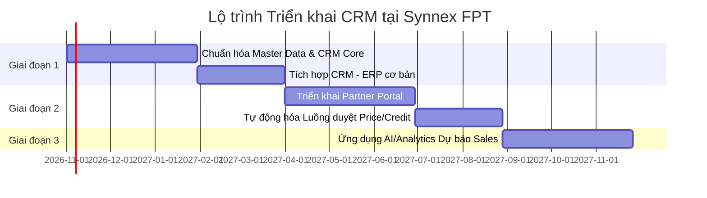

# Phân tích Mô hình Kinh doanh Synnex FPT & Khả năng Ứng dụng CRM

[](https://opensource.org/licenses/MIT)
[](#)
[](https://synnexfpt.com/)

Tài liệu này phân tích mô hình kinh doanh của **Công ty TNHH Phân phối Synnex FPT** (liên doanh giữa Tập đoàn FPT và Tập đoàn Synnex) và đánh giá khả năng, lộ trình ứng dụng hệ thống **Quản trị Quan hệ Khách hàng (CRM)** trong hoạt động B2B Distribution quy mô lớn.

---

## 📋 Mục lục
1. [Tổng quan về Synnex FPT](#1-tổng-quan-về-synnex-fpt)
2. [Phân tích Mô hình Kinh doanh (Business Model Canvas)](#2-phân-tích-mô-hình-kinh-doanh-business-model-canvas)
3. [Bài toán & Khả năng Ứng dụng CRM](#3-bài-toán--khả-năng-ứng-dụng-crm)
4. [Kiến trúc Tích hợp CRM & ERP](#4-kiến-trúc-tích-hợp-crm--erp)
5. [Lộ trình Triển khai Đề xuất](#5-lộ-trình-triển-khai-đề-xuất)

---

## 1. Tổng quan về Synnex FPT

Synnex FPT là một trong những nhà phân phối sản phẩm, giải pháp Công nghệ Thông tin - Viễn thông (ICT) hàng đầu tại Việt Nam.

* **Mô hình hoạt động:** B2B Distribution (Phân phối B2B), B2B2C, Phân phối Giải pháp Doanh nghiệp.
* **Đối tác chính:** Các hãng công nghệ toàn cầu (Dell, HP, Cisco, Intel, Microsoft, Apple, Xiaomi,...).
* **Mạng lưới:** Hàng nghìn đại lý, nhà bán lẻ, chuỗi cửa hàng và đơn vị tích hợp hệ thống (SI) trên toàn quốc.

---

## 2. Phân tích Mô hình Kinh doanh (Business Model Canvas)

| Thành tố | Mô tả chi tiết tại Synnex FPT |
| :--- | :--- |
| **KP (Key Partners)** | • Các hãng sản xuất phần cứng/phần mềm toàn cầu (Vendors).<br>• Mạng lưới đại lý Tier-2, chuỗi bán lẻ (Thế Giới Di Động, FPT Shop,...).<br>• Các đơn vị vận tải/kho vận (3PL) & Ngân hàng cung cấp hạn mức tín dụng. |
| **KA (Key Activities)** | • Quản lý chuỗi cung ứng & Kho vận (Fulfillment/Logistics).<br>• Phát triển & Quản lý kênh phân phối (Channel Management).<br>• Hỗ trợ kỹ thuật, đấu thầu dự án & Dịch vụ bảo hành ủy quyền. |
| **KR (Key Resources)** | • Mạng lưới phân phối và hạ tầng kho bãi toàn quốc.<br>• Mối quan hệ chiến lược với các Vendor công nghệ lớn.<br>• Hệ thống quản trị (ERP/Supply Chain) & Đội ngũ kinh doanh B2B. |
| **VP (Value Propositions)** | • **Cho Vendor:** Năng lực bao phủ thị trường, cam kết doanh số, quản lý kênh minh bạch.<br>• **Cho Đại lý:** Nguồn hàng chính hãng ổn định, tài trợ tín dụng (Credit), hỗ trợ dự án & chính sách chiết khấu/rebate hấp dẫn. |
| **CR (Customer Relationships)** | • B2B Account Management (Quản lý tài khoản đại lý chuyên trách).<br>• Cổng thông tin tự phục vụ dành cho đại lý (Partner Portal). |
| **CH (Channels)** | • Kênh bán hàng B2B trực tiếp qua đội ngũ Sales.<br>• B2B Electronic Portal / EDI.<br>• Mạng lưới Showroom / Trung tâm bảo hành. |
| **CS (Customer Segments)** | • **Retailers/Resellers:** Các đại lý tin học, cửa hàng bán lẻ, chuỗi điện máy.<br>• **System Integrators (SIs):** Đơn vị triển khai dự án cho Khối Chính phủ/Doanh nghiệp.<br>• **Telcos & Service Providers:** Các nhà mạng, cung cấp dịch vụ hạ tầng. |
| **C$ (Cost Structure)** | • Chi phí mua hàng nhập khẩu & Tồn kho.<br>• Chi phí Kho vận (Logistics) & Bảo hành.<br>• Chi phí tài chính (Tỷ giá, lãi vay hạn mức tín dụng).<br>• Chi phí vận hành & Quản lý bán hàng. |
| **R$ (Revenue Streams)** | • Chênh lệch giá bán buôn sản phẩm thiết bị/linh kiện IT.<br>• Doanh thu bản quyền phần mềm & Giải pháp Cloud.<br>• Dịch vụ giá trị gia tăng (VAS): Bảo hành kéo dài, triển khai kỹ thuật. |

---

## 3. Bài toán & Khả năng Ứng dụng CRM

Đối với mô hình phân phối B2B quy mô hàng tỷ USD, hệ thống CRM không chỉ là công cụ quản lý thông tin liên hệ mà là **trung tâm điều phối hoạt động thương mại B2B**.

### Các Trường hợp Sử dụng Cốt lõi (Core Use Cases)

#### 1. Quản lý Đối tác & Phân hạng Đại lý (PRM - Partner Relationship Management)
* Quản lý hồ sơ 360 độ của Đại lý: Doanh số tích lũy, hạn mức nợ, tần suất đặt hàng, phân hạng Tier (Gold/Silver/Bronze).
* Quản lý chính sách thưởng doanh số (Rebate) và quỹ hỗ trợ Marketing (MDF - Market Development Funds) từ các Hãng.

#### 2. Quản lý Cơ hội & Bảo vệ Dự án (Project Opportunity Management)
* Theo dõi các dự án B2B/Enterprise kéo dài nhiều tháng của các đơn vị SIs.
* Quy trình đăng ký và bảo vệ dự án với Hãng (Deal Registration) tránh xung đột kênh.

#### 3. Tự động hóa Quy trình Phê duyệt Tín dụng & Giá Đặc biệt
* Tự động hóa luồng duyệt yêu cầu giá đặc biệt (Special Price Request) cho các đơn hàng số lượng lớn.
* Cảnh báo vượt hạn mức tín dụng (Credit Limit) và đưa ra luồng phê duyệt nhanh cho Sales.

#### 4. Chăm sóc Khách hàng & Quản lý Bảo hành (RMA & Service Case)
* Tiếp nhận và xử lý khiếu nại về tiến độ giao hàng, sai lệch đơn hàng.
* Theo dõi quy trình đổi trả hàng lỗi (RMA - Return Merchandise Authorization) liên kết với Trung tâm Bảo hành.

---

## 4. Kiến trúc Tích hợp CRM & ERP

CRM đóng vai trò **Front-Office** (Tương tác & Bán hàng), liên kết chặt chẽ với hệ thống **ERP** ở **Back-Office** (Kho, Kế toán, Đơn hàng).

```
+-------------------------------------------------------------------+
|                        CUSTOMER / PARTNER                         |
+-------------------------------------------------------------------+
                                  │
                                  ▼
+-------------------------------------------------------------------+
|                        FRONT-OFFICE: CRM                          |
|  - Lead & Opportunity Mgmt       - Special Price Request          |
|  - Partner Portal (Self-Service) - RMA / Service Tickets          |
+-------------------------------------------------------------------+
                                  │
                      (Real-time / RESTful API)
                                  │
                                  ▼
+-------------------------------------------------------------------+
|                         BACK-OFFICE: ERP                          |
|  - Inventory & ATP (Available)  - Credit Limit & A/R             |
|  - Order Fulfillment (WMS)       - Financial Accounting           |
+-------------------------------------------------------------------+
```

---

## 5. Lộ trình Triển khai Đề xuất



### Chi tiết các giai đoạn:

1. **Giai đoạn 1: Chuẩn hóa & Số hóa Quy trình Bán hàng Core (3-6 tháng)**
   * Chuẩn hóa dữ liệu khách hàng (Master Data Management).
   * Triển khai CRM cho đội ngũ Sales B2B: Quản lý Lead, Pipeline, Khách hàng tổ chức.
   * Tích hợp xem tồn kho khả dụng (ATP) và hạn mức công nợ từ ERP.

2. **Giai đoạn 2: Số hóa Kênh Đối tác & Tự động hóa Phê duyệt (6-12 tháng)**
   * Triển khai **Partner Portal**: Cho phép đại lý tự tạo đơn, tra cứu công nợ, theo dõi trạng thái bảo hành.
   * Tự động hóa luồng duyệt xin giá đặc biệt (Special Price) và gia hạn tín dụng khẩn cấp.

3. **Giai đoạn 3: Phân tích Nâng cao & Tối ưu bằng AI (12+ tháng)**
   * Áp dụng AI dự báo nhu cầu đặt hàng của Đại lý (Predictive Reordering).
   * Cảnh báo rủi ro sụt giảm doanh số đại lý (Churn Warning).
   * Tự động hóa phân bổ ngân sách MKT/Rebate từ Hãng dựa trên hiệu suất bán hàng.

---

*Tài liệu được tổng hợp và phân tích phục vụ mục đích nghiên cứu mô hình quản trị doanh nghiệp ICT.*