# Synnex FPT — Chuỗi giá trị vận hành kinh doanh & Đề xuất triển khai Agentic Sales OS

> Nguồn tổng hợp: `synnex_fpt_business_model_crm_application_analysis.md`, `synnex_fpt_crm_proposal_demo_plan.md`, `README.md` (Base Agentic OS), `base-sales-demo-builder.zip`, Knowledge AgentHub / Dataset / Cowork.
> Mục đích: input để (1) dựng **hệ thống dữ liệu demo** và (2) thiết kế **bài pitching** cho Synnex FPT.
> Toàn bộ sơ đồ là Mermaid — dán thẳng vào Obsidian / Notion / GitHub để xem.

---

## 0. Bối cảnh rút gọn

| Chỉ số | Mảng Đại lý (B2B Channel) | Mảng Dự án (B2G / Enterprise) |
|---|---|---|
| Tỷ trọng doanh thu | **70%** | **30%** |
| Số Sales | ~250 | ~50 |
| Tệp khách | ~1.000 Account (chuỗi lớn + đại lý SME) | Bộ ban ngành, đơn vị công, SI, Telco |
| Hệ thống hiện có | Hệ thống PO đại lý riêng | Lead/Deal cơ bản, chưa tối ưu |
| Bài toán lõi | Chăm sóc Account, bán chéo, tự động hoá tệp SME | Pipeline Lead → Thầu → HĐ 3 bên, win rate |

**Nguyên tắc định vị:** Agentic Sales OS là **Front-Office** (tương tác, cơ hội, chăm sóc). Hệ thống PO/ERP giữ vai trò **Back-Office** (đơn hàng, tồn kho, công nợ). Không demo luồng tạo đơn để tránh trùng với PO hiện tại.

---

## 1. Chuỗi giá trị tổng thể (Hoạt động chính)

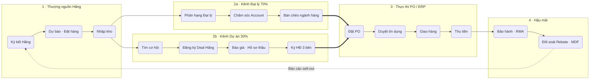

**Logic**: Chuỗi chạy trái → phải từ Hãng đến hậu mãi, tách làm 2 làn bán hàng song song (Đại lý / Dự án) vì hai mảng có mô hình quản trị khác nhau. Cả hai làn hội tụ về PO/ERP bằng mũi tên `==>` (critical path — nơi doanh thu thực sự ghi nhận). Mũi tên đứt quay về Hãng thể hiện vòng phản hồi sell-out quyết định rebate/MDF kỳ sau.

### 1.1 Hoạt động hỗ trợ

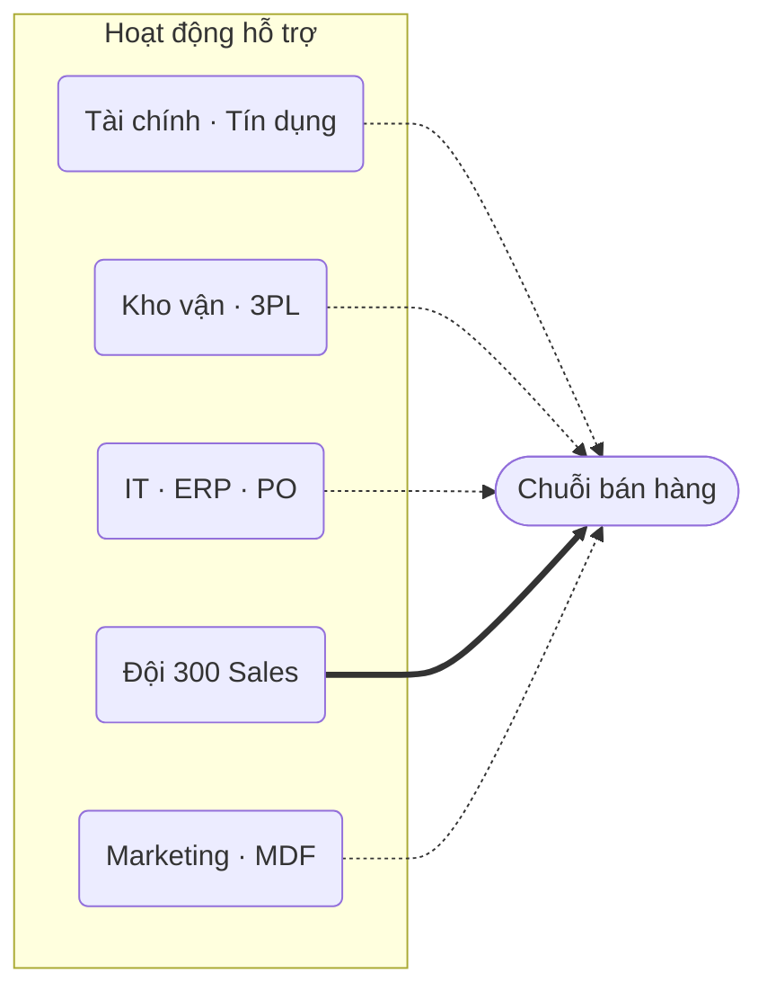

**Logic**: Năm hoạt động hỗ trợ fan-in vào chuỗi chính. Đội Sales là đường `==>` vì đây là chi phí vận hành lớn nhất và là đối tượng trực tiếp được Agentic Sales OS "nhân bản năng lực".

### 1.2 Điểm nghẽn theo chặng — dùng cho slide "Pain → Gain"

| Chặng | Điểm nghẽn hiện tại | KPI đo được | Ai đau nhất |
|---|---|---|---|
| Phân hạng Đại lý | Phân hạng theo cảm tính, không cập nhật theo doanh số thực | % Account có tier đúng | Trưởng kênh |
| Chăm sóc Account | Lịch sử tương tác nằm ở Zalo/Excel cá nhân, mất khi Sales nghỉ | Số tương tác / Account / tháng | Giám đốc kinh doanh |
| Bán chéo | Không thấy đại lý "đã mua gì – chưa mua gì" theo ngành hàng | Số ngành hàng / Account | Sales, PM ngành hàng |
| Tệp SME | ~70% Account doanh thu nhỏ, không có Sales phụ trách | % SME được chạm / tháng | Ban điều hành |
| Đăng ký Deal Hãng | Xung đột kênh, deal không được Hãng bảo vệ | Tỷ lệ deal được bảo vệ | Sales dự án |
| Báo giá · Thầu | Duyệt giá đặc biệt qua email, chậm, không lưu vết | Thời gian duyệt Special Price | Sales, Tài chính |
| Ký HĐ 3 bên | Deal "ngâm" lâu ở giai đoạn thầu, quản lý không biết | Số deal quá SLA | Trưởng mảng dự án |
| Duyệt tín dụng | Vượt hạn mức mới biết, chặn đơn | Số đơn bị chặn vì credit | Sales, Tài chính |
| RMA | Khiếu nại giao hàng / đổi trả không nối với Account | Thời gian xử lý ticket | CSKH |
| Rebate · MDF | Đối soát thủ công, chậm nhận tiền từ Hãng | Ngày đối soát / quý | Tài chính, PM Hãng |

---

## 2. Kiến trúc Agentic Sales OS đề xuất cho Synnex FPT

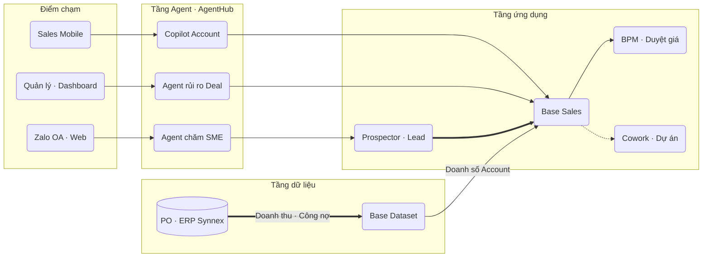

**Logic**: Layered 4 tầng — điểm chạm → agent → ứng dụng → dữ liệu. Base Sales là "xương sống" nhận Lead từ Prospector/Lead và đẩy luồng duyệt sang BPM. Dữ liệu PO/ERP đi một chiều vào Base Dataset (critical path), để mọi agent và báo cáo đọc doanh thu thật mà Sales không phải nhập lại.

### 2.1 Bản đồ chặng chuỗi giá trị → module Base

| Chặng chuỗi giá trị | Module Base | Vai trò agent | Ưu tiên demo |
|---|---|---|---|
| Phân hạng Đại lý | Base Sales (Account directory + Segmentation) · Dataset | Agent tự đề xuất tier theo doanh số PO 12 tháng | ★★★ |
| Chăm sóc Account | Base Sales (Account 360, Work stream, Tasks) | Copilot tóm tắt Account, soạn kế hoạch thăm | ★★★ |
| Bán chéo ngành hàng | Base Sales (pipeline Cross-sell) · Dataset | Agent phát hiện "khoảng trống ngành hàng" | ★★★ |
| Chăm sóc tệp SME | Base Prospector · Base Lead · AgentHub | Chatbot Zalo trả lời chính sách, chuyển Lead nóng | ★★★ |
| Đăng ký Deal Hãng | Base Sales (pipeline Dự án) · BPM | Agent kiểm tra trùng deal, soạn hồ sơ đăng ký | ★★ |
| Báo giá · Hồ sơ thầu | Base Commerce (Quotes) · BPM · Esigns | Agent soạn báo giá, kiểm tra biên lợi nhuận | ★★ |
| Ký HĐ 3 bên | Base Sales (Contract) · Esigns · Cowork | Agent cảnh báo deal quá SLA | ★★★ |
| Duyệt tín dụng · giá đặc biệt | Base BPM | Agent chuẩn bị tờ trình, gợi ý cấp duyệt | ★★ |
| Bảo hành · RMA | Base Service | Agent phân loại ticket, gắn vào Account | ★ |
| Đối soát Rebate · MDF | Dataset · AgentHub | Agent đối soát sell-out vs chính sách Hãng | ★ (Giai đoạn 3) |

★★★ = bắt buộc có trong buổi demo đầu · ★★ = demo nếu đủ thời gian · ★ = chỉ nói trong roadmap.

---

## 3. Đội ngũ Agent đề xuất

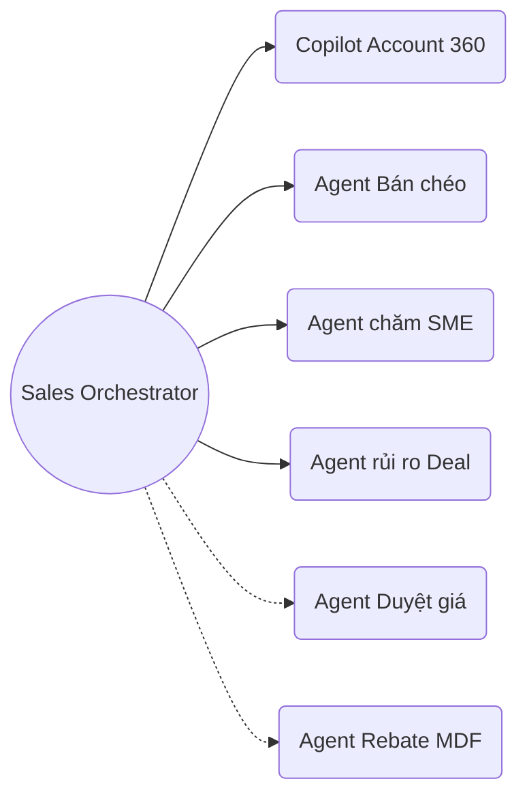

**Logic**: Hub-and-spoke — một agent điều phối (dùng cơ chế *agent-as-tool* của AgentHub) gọi các agent chuyên trách. 4 agent nét liền là phạm vi demo/PoC; 2 agent nét đứt thuộc giai đoạn sau.

| Agent | Đầu vào | Đầu ra | Mức tự chủ đề xuất | Nơi chạy |
|---|---|---|---|---|
| Copilot Account 360 | Account, Work stream, doanh số PO | Tóm tắt 5 dòng + 3 hành động kèm người, hạn | Gợi ý — người quyết | Copilot trong Base Sales |
| Agent Bán chéo | Ma trận Account × ngành hàng | Danh sách đại lý có khoảng trống + kịch bản tư vấn | Tự tạo Deal nháp, Sales xác nhận | AgentHub + Dataset |
| Agent chăm SME | Hỏi đáp Zalo/Web, chính sách, danh mục | Trả lời + tạo Lead khi có tín hiệu mua lớn | Tự trả lời, tự chuyển Lead | Prospector + AgentHub |
| Agent rủi ro Deal | Deal B2G, rotting, custom field | Cảnh báo deal thiếu người quyết định / quá SLA | Tự cảnh báo, không tự sửa deal | Copilot rule pipeline |
| Agent Duyệt giá | Yêu cầu giá đặc biệt, biên LN, credit | Tờ trình duyệt soạn sẵn | Soạn nháp, người duyệt ký | BPM + AgentHub |
| Agent Rebate MDF | Sell-out, chính sách Hãng | Bảng đối soát, chênh lệch | Soạn nháp | AgentHub + Dataset |

### 3.1 Mẫu AI Copilot rule — pipeline Dự án B2G (dán vào `Setting → AI Copilot`)

> **Tiêu đề:** *Kiểm soát deal dự án B2G và HĐ 3 bên*
>
> Dựa trên dữ liệu deal, xác định: chủ đầu tư, đơn vị SI/đối tác, Hãng đã đăng ký deal hay chưa, hình thức lựa chọn nhà thầu, ngày mở thầu, giá trị dự kiến, biên lợi nhuận đề xuất. Phân biệt deal đã được Hãng bảo vệ và deal chưa đăng ký. Ở giai đoạn Báo giá/Hồ sơ thầu phải có giá đặc biệt đã duyệt; ở giai đoạn Đàm phán HĐ 3 bên phải có đủ 3 bên ký và điều khoản thanh toán. Nêu rõ thông tin đã có và còn thiếu, không tự bịa giá, chiết khấu hay cam kết của Hãng. Đề xuất tối đa 3 hành động kèm người phụ trách và hạn. Cảnh báo deal quá ngưỡng rotting, thiếu người quyết định, hoặc ngày mở thầu đã qua mà chưa cập nhật kết quả.

---

## 4. Luồng nghiệp vụ trọng tâm cho demo

### 4.1 Use Case 1 — Account Care & Bán chéo (Kênh Đại lý)

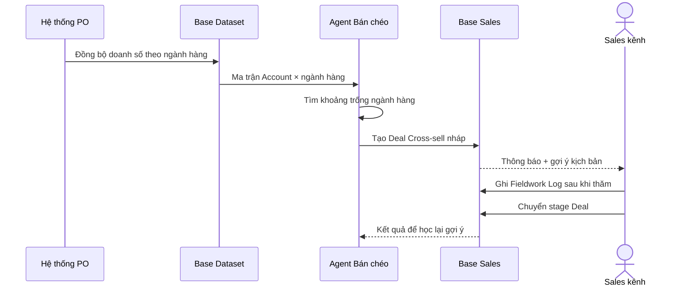

**Logic**: Doanh số từ PO đi vào Dataset (không nhập tay), agent đọc ma trận để phát hiện đại lý "đã mua Máy tính nhưng chưa mua Thiết bị mạng", rồi tạo deal nháp cho Sales xác nhận. Sales chỉ làm việc của con người: đi thăm, ghi log, chốt.

### 4.2 Use Case 2 — Pipeline Dự án B2G

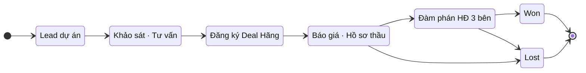

**Logic**: Thêm stage "Đăng ký Deal Hãng" so với bản kế hoạch gốc — đây là đặc thù riêng của nhà phân phối (bảo vệ dự án với Hãng, tránh xung đột kênh) và là điểm khiến khách thấy "hệ thống hiểu nghề mình".

**Cấu hình stage đề xuất (Probability / Rotting):**

| Stage | Probability | Rotting (ngày) | Field bắt buộc khi rời stage |
|---|---|---|---|
| Lead dự án | 10% | 5 | Primary Account (chủ đầu tư) |
| Khảo sát · Tư vấn | 25% | 10 | Người quyết định, Ngân sách dự kiến |
| Đăng ký Deal Hãng | 40% | 7 | Mã đăng ký Hãng, Hãng |
| Báo giá · Hồ sơ thầu | 60% | 14 | Ngày mở thầu, Giá đặc biệt đã duyệt |
| Đàm phán HĐ 3 bên | 85% | 10 | Đơn vị SI, Điều khoản thanh toán |

**Lost reasons (tiếng khách):** `Thua giá trong thầu` · `Hãng không bảo vệ dự án` · `Chủ đầu tư hoãn ngân sách` · `Đối tác SI chuyển nhà phân phối khác`.
**Won reasons:** `Được Hãng bảo vệ giá` · `Đáp ứng tiến độ giao hàng`.

### 4.3 Use Case 3 — Chăm sóc tự động tệp SME

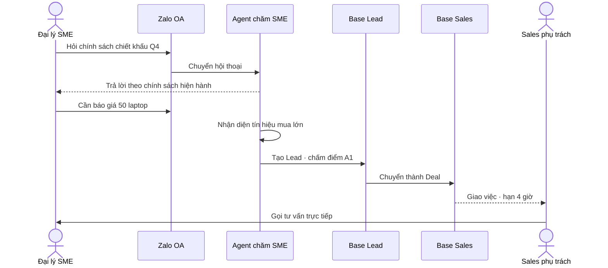

**Logic**: Bot xử lý 80% câu hỏi lặp lại; chỉ khi phát hiện tín hiệu "đơn lớn" mới tạo Lead và giao Sales kèm SLA. Đây là câu trả lời trực tiếp cho bài toán "250 Sales không thể chạm hết 1.000 Account".

### 4.4 Luồng duyệt giá đặc biệt & tín dụng

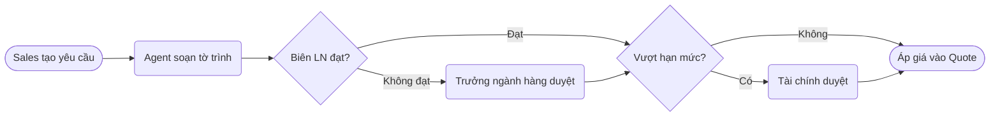

**Logic**: Decision flow 2 cổng — biên lợi nhuận rồi hạn mức tín dụng. Agent chỉ soạn tờ trình và đọc số credit từ ERP; quyết định luôn thuộc con người (chạy trên Base BPM vì automation cấp deal của Base Sales đang "coming soon").

---

## 5. Mô hình dữ liệu demo

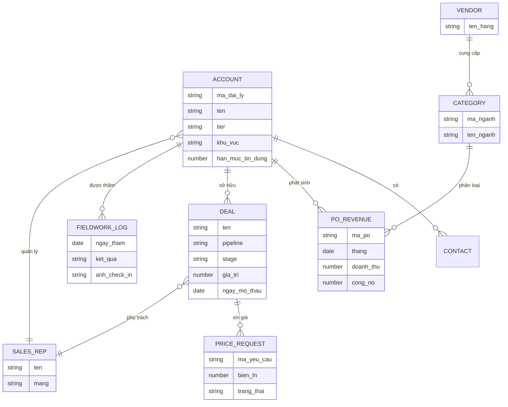

**Logic**: `ACCOUNT` là trung tâm (Account 360). `PO_REVENUE` sống ở Base Dataset (nguồn từ PO/ERP), các bảng còn lại sống trong Base Sales. Quan hệ `CATEGORY ← PO_REVENUE` là thứ tạo ra ma trận bán chéo.

### 5.1 Quy mô dữ liệu demo khuyến nghị

| Đối tượng | Số lượng | Ghi chú dựng dữ liệu |
|---|---|---|
| Sales rep (persona) | 4 | 2 Sales kênh (Bắc, Nam), 1 Sales dự án, 1 Trưởng kênh |
| Account đại lý | 40 | 6 Key Account · 12 Gold · 22 SME — đủ để ma trận bán chéo có "lỗ" |
| Account dự án | 12 | Sở/ban ngành, bệnh viện, ngân hàng, SI |
| Contact | ~90 | 1–3 người / Account, có chức danh và SĐT |
| Ngành hàng | 6 | Máy tính · Linh kiện & Ngoại vi · Thiết bị mạng · Smart Device · Phần mềm & Cloud · Giải pháp CNTT |
| Hãng | 8 | Dell, HP, Cisco, Intel, Microsoft, Apple, Xiaomi, Lenovo |
| Dòng doanh số PO | 40 Account × 12 tháng × 2–4 ngành ≈ 1.400 dòng | Có mùa vụ (Q4 cao, Tết thấp), 3 đại lý sụt doanh số rõ để Agent cảnh báo |
| Deal Cross-sell | 12 | Rải 4 stage |
| Deal B2G | 18 | Rải theo playbook: 3 / 4 / 3 / 5 / 3, 1 deal "rất lớn" ở Báo giá · Thầu |
| Fieldwork Log | ~30 | Rải 60 ngày gần nhất, không dồn cùng ngày |
| Yêu cầu giá đặc biệt | 5 | 2 đã duyệt, 2 đang chờ, 1 bị trả lại |

**Lưu ý dựng dữ liệu:**
- Dùng tên đại lý **hư cấu nhưng đúng chất ngành** (ví dụ `Tin học Minh Khang – Cần Thơ`, `Chuỗi Điện máy Sao Việt`, `Công ty CP Tích hợp Hệ thống Đông Á`). Chỉ dùng tên chuỗi thật nếu Synnex FPT đồng ý cung cấp.
- Tiền tệ VND toàn bộ — form tạo Account mặc định USD, phải đổi tay.
- Thứ tự nạp bắt buộc: **Account → Contact → Deal**; nạp trước buổi demo 1–2 ngày để tránh tất cả đều `just now`.
- Đặt sẵn 3 "câu chuyện" trong dữ liệu: (1) 1 Key Account mua Máy tính đều nhưng chưa mua Thiết bị mạng; (2) 1 deal B2G lớn đã ngâm quá SLA ở "Báo giá · Hồ sơ thầu"; (3) 1 đại lý SME hỏi Zalo rồi thành Lead A1.

---

## 6. Lộ trình triển khai

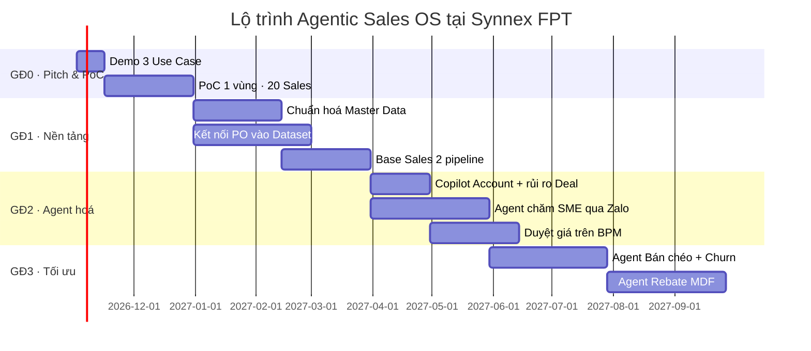

**Logic**: Bắt đầu bằng PoC nhỏ (1 vùng, 20 Sales) để chứng minh giá trị trước khi chuẩn hoá toàn bộ 1.000 Account. Kết nối PO chạy song song với chuẩn hoá Master Data vì mọi agent ở GĐ2–3 đều phụ thuộc dữ liệu doanh số thật.

---

## 7. Khung bài pitching

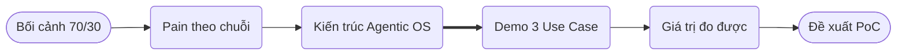

**Logic**: Pipeline 6 bước — khách nhìn thấy chuỗi giá trị của chính mình trước, rồi mới thấy giải pháp. Demo là critical path (`==>`), chiếm ~60% thời lượng.

| Phần | Thời lượng | Nội dung chính | Sơ đồ dùng |
|---|---|---|---|
| Bối cảnh 70/30 | 3 phút | 2 mảng, 300 Sales, 1.000 Account | §0 |
| Pain theo chuỗi | 5 phút | Đi qua chuỗi giá trị, chỉ ra 4–5 điểm nghẽn | §1, §1.2 |
| Kiến trúc Agentic OS | 5 phút | 4 tầng, Base đứng cạnh PO/ERP chứ không thay thế | §2, §3 |
| Demo 3 Use Case | 25 phút | Account Care & Bán chéo → Pipeline B2G → Chatbot SME | §4 |
| Giá trị đo được | 4 phút | KPI theo chặng (bảng §1.2) | §1.2 |
| Đề xuất PoC | 3 phút | 1 vùng, 20 Sales, 45 ngày, tiêu chí thành công | §6 |

**Câu chốt gợi ý:** *"Synnex FPT không thiếu hệ thống đơn hàng — cái đang thiếu là một lớp vận hành giúp 300 Sales chạm đúng 1.000 Account vào đúng lúc, với đúng ngành hàng. Đó là việc của Agentic Sales OS."*

---

## 8. Điểm cần xác nhận trước khi cam kết với khách

| Điểm | Thực tế đã kiểm chứng | Cách trả lời / phương án |
|---|---|---|
| Automation, SLA, Agent flows trên **từng deal** | Base Sales ghi "coming soon" | SLA làm ở cấp pipeline (rotting); automation và phê duyệt chạy trên **Base BPM** / **AgentHub** |
| Webhook outbound từ Base Sales | "Lands in the next iteration" | Dữ liệu chảy **vào** Base qua Dataset (kết nối PostgreSQL/Supabase) hoặc import định kỳ |
| Kết nối PO/ERP của Synnex | Chưa khảo sát API | Cần buổi khảo sát kỹ thuật với IT Synnex; nếu có bản sao Postgres thì nối thẳng Dataset |
| Nạp tài liệu vào Knowledge base AgentHub | Ghi nhận lỗi Parse lúc khảo sát 08/2026 | Kiểm tra lại trên tenant trước buổi demo; dự phòng đưa chính sách vào Instruction của agent |
| Kết nối Zalo OA cho chatbot | Chưa có trong tài liệu repo | Xác nhận với product Base Prospector trước khi hứa |
| Copilot | Chỉ chạy khi đang mở deal / account / report | Mở sẵn deal đầy dữ liệu rồi mới bấm Copilot |
